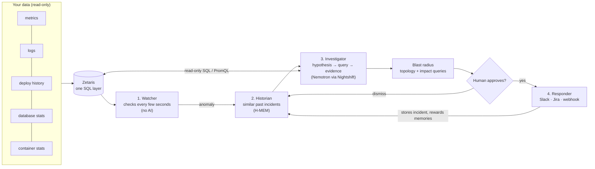
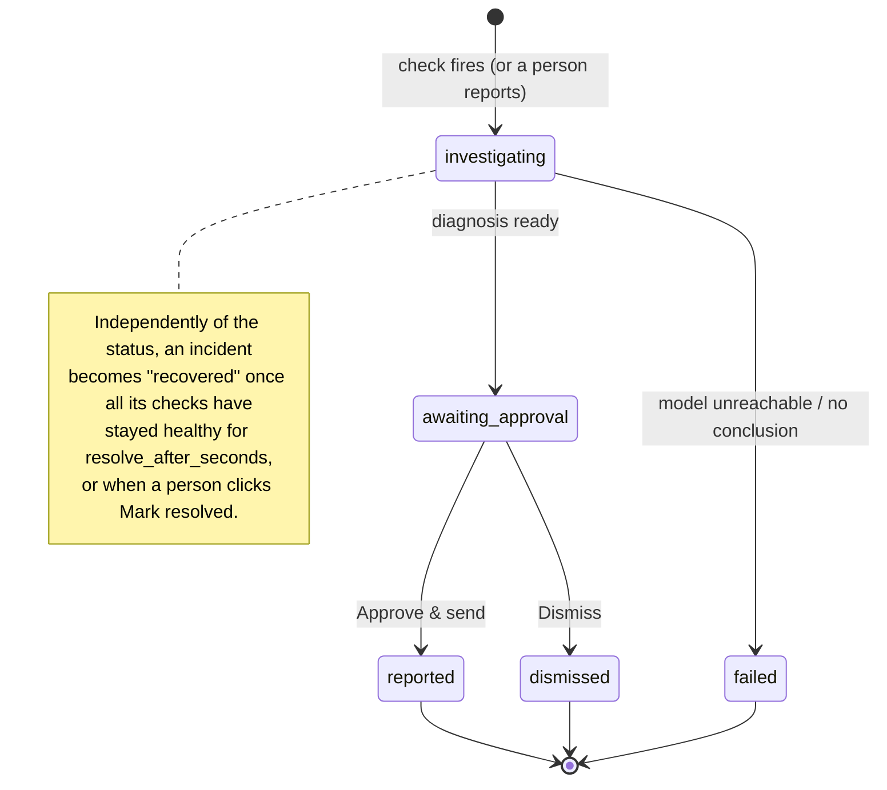

# Overwatch

**An AI on-call team for your software.** Overwatch watches a running system, notices when something breaks, works out *why* by querying your data the way an engineer would, shows its evidence, and, after a human approves, reports it to Slack and Jira.

Monitoring tools tell you *that* something is wrong. Overwatch tells you **what broke, why, what it is costing, and what to do about it**, with the queries that prove it.

Built for **HackOS 2026**, Track 02: *The Agent That Can Explain Why*.

---

## Contents

1. [Why Overwatch exists](#1-why-overwatch-exists)
2. [What it does, in one minute](#2-what-it-does-in-one-minute)
3. [How it works](#3-how-it-works)
4. [Sponsor technology](#4-sponsor-technology)
5. [Quick start: the demo in 10 minutes](#5-quick-start-the-demo-in-10-minutes)
6. [Using Overwatch on your own system](#6-using-overwatch-on-your-own-system)
7. [Configuration reference](#7-configuration-reference)
8. [The console](#8-the-console)
9. [Command-line reference](#9-command-line-reference)
10. [HTTP API reference](#10-http-api-reference)
11. [The demo system and its 19 faults](#11-the-demo-system-and-its-19-faults)
12. [Testing, verification and evaluation](#12-testing-verification-and-evaluation)
13. [Incident lifecycle in detail](#13-incident-lifecycle-in-detail)
14. [Security model](#14-security-model)
15. [Extending Overwatch](#15-extending-overwatch)
16. [Troubleshooting](#16-troubleshooting)
17. [Known limitations and roadmap](#17-known-limitations-and-roadmap)
18. [Repository layout](#18-repository-layout)
19. [Pre-existing code and licenses](#19-pre-existing-code-and-licenses)

---

## 1. Why Overwatch exists

When production breaks, an on-call engineer gets an alert like *"checkout error rate above 5%"* and then spends the next half hour (often at 3 a.m.) jumping between dashboards, logs, the deploy history, database statistics and old tickets, guessing at causes and checking them one by one.

Most of that work is mechanical: form a hypothesis, run a query, look at the result, refine. It is exactly the kind of loop an AI agent can do, **if** it is given the right data, strict safety limits and a human in charge of every outgoing action.

**Target user:** an on-call engineer or SRE on a small-to-mid team running services.
**What success looks like:** a correct, evidence-backed root cause in front of a human in minutes instead of an hour, with the business impact already measured.

---

## 2. What it does, in one minute

1. **Watches** your signals every few seconds: latency, error rates, CPU, restarts, heartbeats. Alerts when a value crosses a fixed limit, rises far above its own normal, or stops reporting.
2. **Remembers** past incidents (Meterless **H-MEM**) and recalls similar ones when something breaks.
3. **Investigates**: an AI model (**NVIDIA Nemotron**, through **Meterless Nightshift**) forms hypotheses and tests them with read-only queries against your data, step by step, until it can name the root cause with evidence.
4. **Measures the blast radius**: which services are affected or at risk, when it started, how fast it was caught, how long it has lasted, and what it is costing (failed checkouts, revenue at risk).
5. **Waits for you.** Nothing is sent until a human clicks *Approve*. Then it posts to Slack, opens a Jira ticket, and teaches its memory.
6. **Notices recovery** on its own once everything is healthy again.

All of it is visible live in a web console with a **map of your system** that turns red or grey where things are failing or not responding.

**Real example** (from this project's own testing, model `nvidia/nemotron-3-ultra-550b-a55b`): after a release silently dropped a database index, Overwatch ran 7 queries (error trend, downstream services, container health, recent deploys, the table's indexes, scan statistics, the slow query) and concluded, at 98% confidence:

> *"The orders service deploy v1.8.0 dropped the index on orders.customer_id. Without this index, queries do sequential scans on 3M rows, causing latency to spike from ~4ms to ~9s, exceeding the gateway's 1s timeout and triggering 100% error rate on /checkout."*
>
> Recommended fix #1: `CREATE INDEX orders_customer_id_idx ON orders (customer_id);`

---

## 3. How it works

### The four agents



| Agent | What it does | Uses AI? | Powered by |
|---|---|---|---|
| **Watcher** | Runs every check on an interval. Fires on a fixed threshold, a multiple of the check's own recent normal, missing data, or a failed heartbeat. Opens incidents; merges related alerts into one. | No: plain arithmetic, so it is fast, cheap and predictable | Your data sources |
| **Historian** | Looks up past incidents with similar symptoms and hands them to the Investigator as hints. | No (retrieval) | **Meterless H-MEM** |
| **Investigator** | Runs a loop: think, pick one read-only query, read the result, repeat, within a step budget. Concludes with root cause, confidence, severity, the service where the cause lives, and concrete fixes. | Yes | **NVIDIA Nemotron** via **Meterless Nightshift** |
| **Responder** | After a human approves: sends the report to every notifier, stores the confirmed incident in memory, and gives feedback to the memories that helped. On dismiss: sends nothing and penalizes memories that misled. | No | Slack, Jira, webhooks |

### Design principles

- **Read-only, always.** Agents can only run a single `SELECT`/`WITH` statement per query, with a row cap and a timeout, inside a read-only transaction where the database supports it. Use a read-only database user anyway.
- **Human in the loop.** Nothing leaves Overwatch without an explicit approval (unless you opt into `approval: auto`).
- **Deterministic where possible.** Detection, start time, spread and business impact are computed from data, not by the model. The model only does the reasoning: which hypotheses to test and what the evidence means.
- **Evidence, not vibes.** Every conclusion cites the queries it relied on; every query and its results are kept and shown.
- **System-agnostic.** Nothing in `overwatch/` knows about the demo. A user describes their system in one YAML file.
- **Watching never stops.** Investigations run in the background on a small worker pool, so checks keep running while the model thinks.

### What happens when something breaks (step by step)

1. The Watcher's pass finds `gateway_error_rate = 0.59` above its limit of `0.05`.
2. If an incident opened in the last few minutes is still open, the alert **joins it** (one cascade = one incident). Otherwise a new incident opens and is handed to the worker pool.
3. The **evidence pack** runs (recent changes, top errors, container state, per-service health...), Overwatch computes the **incident timeline** (when it started, each signal's normal value vs now), and the Historian asks H-MEM for similar past incidents. A **fast model** posts a first guess within seconds.
4. The Investigator receives: the system description, the list of data sources, the **catalog** (what tables and columns exist), the service **topology**, the anomalies, the similar incidents, and its query budget. It replies with one JSON action at a time:
   ```json
   {"thought": "Errors are all timeouts calling orders. Is orders itself slow?",
    "action": "query", "source": "opsdb",
    "query": "SELECT service, avg(p95_ms) FROM request_metrics WHERE ts > now() - interval '5 minutes' GROUP BY 1",
    "purpose": "latency per service"}
   ```
   …and finally:
   ```json
   {"action": "conclude", "root_cause": "...", "confidence": 0.9, "severity": "high",
    "origin_service": "orders", "evidence_steps": [2, 5, 6], "memory_used": [],
    "recommended_actions": ["...", "..."]}
   ```
   This JSON-action protocol works with **any** OpenAI-compatible provider, even without native tool calling.
5. The conclusion must list the explanations it considered (confirmed / ruled out, and why), quote the evidence it relied on, and say whether it agrees with the first guess. Overwatch **checks every quote and technical term against the data** (`overwatch/grounding.py`): a conclusion that cites things not in the data cannot claim more than 60% confidence. If the model uses its whole query budget without concluding, the incident is marked **failed** (never offered for approval empty-handed).
6. Overwatch computes the **blast radius**: start time (walking back through the check history), affected and at-risk services (from the topology), and business cost (from your impact queries).
7. The console shows the diagnosis; a human approves or dismisses.
8. When every check behind the incident has stayed healthy for a while, the incident is marked **recovered** and its final duration is recorded.

---

## 4. Sponsor technology

| Technology | Requirement | How Overwatch uses it | Where to see it |
|---|---|---|---|
| **Zetaris** | Data layer | The intended single place the agents read from: one SQL endpoint that federates metrics, logs, deploy history, tickets and database stats from separate systems, so the Investigator can join across them in one query. Configured as `type: zetaris`. | `sources:` in `overwatch.yaml`; the console header (*Data*) |
| **Meterless H-MEM** (engine, "Build") | At least one engine in a working feature | Incident memory. Confirmed incidents are stored in the long-term tier with provenance (`source`) and confidence; human approval/dismissal becomes `helpful` / `not_helpful` feedback that changes confidence; every change is written to the trust ledger (`ledger.jsonl`). **Official conformance suite: 13/13 passing.** | `memory-service/`, [`eval/hmem-conformance.md`](eval/hmem-conformance.md), the console's *Under the hood → Memory* |
| **Meterless Nightshift** (provider, "Power") | Primary AI provider | Every model call goes through one OpenAI-compatible client (`overwatch/llm.py`) pointed at Nightshift's local endpoint, with the `meterless-app` / `meterless-scope` headers and the bearer token from Nightshift's `proxy-token` file. Each call is logged to `traces/llm_calls.jsonl`. | `.env` (`LLM_BASE_URL`), the console's *Under the hood → AI calls* |
| **NVIDIA Nemotron** | Model (NVIDIA award) | Powers the Investigator's reasoning. Connected as a provider inside Nightshift; during development it can also be called directly at `integrate.api.nvidia.com`. Tested with `nvidia/nemotron-3-ultra-550b-a55b`. | The console header (*AI*) |

> **Status, honestly:** the demo currently reads two Postgres databases directly (Zetaris not yet installed), and the Investigator has been tested against NVIDIA's API directly because Nightshift has no Linux edition. Switching to Nightshift is a two-line change in `.env` (see [Using Nightshift from another machine](#using-nightshift-from-another-machine)). Switching to Zetaris is replacing the two `sources` with one.

---

## 5. Quick start: the demo in 10 minutes

### Prerequisites

| Tool | Version | Used for |
|---|---|---|
| Python | 3.11+ | Overwatch itself |
| Node.js | 20+ | The H-MEM memory service and (only if you change it) the console |
| Docker + Docker Compose | recent | The demo shop |
| An AI provider | — | Meterless Nightshift, or a free NVIDIA API key from https://build.nvidia.com for development |

### 1. Install

```bash
git clone <this repository> overwatch && cd overwatch

# Python package and CLI
python -m venv .venv
. .venv/bin/activate
pip install -e ".[dev]"

# H-MEM memory service
(cd memory-service && npm install)
```

The console is already built into `overwatch/ui/dist`; you only need `web/` if you want to change it.

### 2. Configure secrets

```bash
cp .env.example .env
```

Edit `.env` (it is git-ignored). For development without Nightshift, use NVIDIA directly:

```dotenv
LLM_BASE_URL=https://integrate.api.nvidia.com/v1
LLM_API_KEY=nvapi-...                                  # from build.nvidia.com
OVERWATCH_MODEL=nvidia/nemotron-3-ultra-550b-a55b
MEMORY_URL=http://127.0.0.1:8099
OVERWATCH_TOKEN=pick-a-console-password                # optional, locks the console
```

Not every Nemotron model is enabled on every NVIDIA account. If you get `404 ... Not found for account`, try another one from `curl https://integrate.api.nvidia.com/v1/models`.

### 3. Start the demo shop

```bash
cd examples/demo-system
docker compose up -d --build        # first build takes a few minutes; Postgres seeds 3M orders
```

This starts a gateway, an orders service, two payments replicas, Postgres (on port **55432**), a container-metrics collector, a "chaos" service (the outside world) and a load generator sending ~15 checkouts per second.

### 4. Start the memory service and seed past incidents

In a second terminal:

```bash
cd memory-service && npm start                       # H-MEM on http://127.0.0.1:8099
```

Back in the first:

```bash
cd examples/demo-system
../../.venv/bin/python scripts/seed_memory.py         # loads 5 past incident tickets into H-MEM
```

### 5. Check everything is connected

```bash
../../.venv/bin/overwatch -c overwatch.yaml doctor
```

Every line should say `[ok]`: both data sources, the AI provider, memory, all 10 checks and the impact queries.

### 6. Start Overwatch and open the console

```bash
../../.venv/bin/overwatch -c overwatch.yaml run
```

Open **http://127.0.0.1:8080**. If you set `OVERWATCH_TOKEN`, open `http://127.0.0.1:8080/?token=<your token>` once; the browser remembers it.

You should see *"All systems normal"* and a map of five green services.

### 7. Break something and watch

In another terminal:

```bash
cd examples/demo-system
../../.venv/bin/python scripts/inject_fault.py slow_query
```

Within ~30 seconds the banner turns amber, `orders` and `gateway` go red on the map, and the agents panel shows the Investigator working. In 1–4 minutes the *Why* box fills in with the diagnosis and the *Approve & send report* button appears.

Fix it again:

```bash
../../.venv/bin/python scripts/inject_fault.py reset
```

About a minute later the incident turns green: *Recovered*.

Or let Overwatch show you several faults in a row:

```bash
cd scripts && ../../../.venv/bin/python tour.py
```

---

## 6. Using Overwatch on your own system

Overwatch does not plug into your services. It reads the data they already produce. Give it read-only access to that data and describe your system in one file.

### What data it needs

| Data | Lets Overwatch… | Typical home |
|---|---|---|
| Per-service metrics (latency, errors, request rate) | detect problems; see which service is slow or failing | Prometheus, a metrics table |
| Application logs | read the actual error messages | Elasticsearch/Loki (via Zetaris), a logs table |
| Deploy and config change history | connect a problem to the change that caused it | CI/CD, a `deploys` table |
| Database statistics (`pg_stat_activity`, `pg_stat_statements`, `pg_locks`, `pg_indexes`) | find slow queries, locks, missing indexes, connection problems | the database itself |
| Container/host metrics (CPU, memory, restarts, OOM kills, running state) | find leaks, crashes, saturation; know if a service is alive | Kubernetes/cAdvisor, Docker |
| Past incident tickets | give the Historian something to remember | Jira export |

The more of this you connect, the better the investigations. Through **Zetaris** you can expose all of it as one SQL source.

### Connecting: three ways

You do not have to write the configuration by hand. Tell Overwatch **where things are**; it discovers the rest and writes `overwatch.yaml` (and the secrets into `.env`) for you to review.

**1. The setup page (easiest).** Run Overwatch in a folder with no config yet:

```bash
overwatch run          # no overwatch.yaml here yet -> the console opens on "Connect your system"
```

1. **Connect:** Docker is detected automatically (pick the Compose project); optionally add a Prometheus address and any databases or Zetaris; choose an AI provider (one click fills Nightshift or NVIDIA) and **Test connection**.
2. **Review:** a map of the discovered system, a sentence per service to fill in (TODOs are highlighted: they help the Investigator most), the proposed checks with a reason for each (switch any off), the evidence pack, and a preview of the file it will write.
3. **Save and start watching:** writes the files and starts watching immediately, no restart. An existing config is kept as a backup. The **Setup** link in the console header brings you back here.

**2. One command:**

```bash
overwatch connect --docker --project my-shop \
                  --prometheus http://prometheus:9090 \
                  --database ops=postgresql://readonly:password@db:5432/ops
overwatch doctor          # every line should say [ok]
overwatch run
```

`--print` shows the generated file without writing it.

**3. By hand:** `overwatch init` writes a commented starter file; see the [configuration reference](#7-configuration-reference).

### What discovery finds

| From | It discovers |
|---|---|
| **Docker / Docker Compose** | services (replicas grouped as one), **who calls whom** (Compose's `depends_on` labels), CPU and memory limits, restart policy, **health endpoints** (tries `/health`, `/healthz`, `/ready`, `/status` on published ports), and a liveness check per service |
| **SQL databases / Zetaris** | every table and column for the catalog; a **change log** (columns like `service` + `version` + a timestamp), **logs** (`level` + `message`) and **metrics** tables (`service` + latency/error columns), turned into per-service latency and error checks; the database's own health views (`pg_stat_activity`, `pg_stat_statements`...) |
| **Prometheus** | standard request metrics (`http_requests_total`, `http_request_duration_seconds`, OpenTelemetry names) and `up`, turned into per-service latency, error-rate and liveness checks |

Latency checks use **compare-to-normal** (4× the service's own recent median), so nobody has to guess a threshold. Database addresses with passwords and the AI key go into `.env`, never into `overwatch.yaml`.

### External services

Third-party APIs and managed services (a payment provider, email, a hosted database) are invisible to Docker, so discovery looks for two clues:

- **Your services' settings:** addresses in container environment variables (`PAYMENT_API_URL=https://api.stripe.com`, `SMTP_HOST=smtp.sendgrid.net`). Only the hostname is kept; the value (which can contain credentials) is never stored or shown. Your own containers, cluster-internal names and raw IPs are ignored.
- **Your error logs:** hosts named in recent errors (`POST https://psp.example.com/v1/charge returned 429`), from Docker logs or a logs table.

Each one is suggested with the evidence ("payments has it in the PROVIDER_URL setting") and the services that call it. On the setup page you can accept, rename or drop suggestions, add any that were missed, and give each one:

- **who calls it**: adds it to the topology, so the map and blast radius include it;
- **a health or status URL** (optional): becomes a probe, so Overwatch can tell "it's them" from "it's us";
- **text that appears in your error logs when it fails** (optional): becomes a check ("more than 5 such errors in 2 minutes") on the logs table, or on Docker logs (`count <callers> 2 <text>`).

In the demo shop, payments reaches the card processor through `PROVIDER_URL=http://psp.example.com:8000/psp`, so discovery finds `psp.example.com` on its own.

Discovery still cannot know what each service is *for*: fill in the one-line descriptions. Kubernetes discovery is not supported yet.

### Built in, no setup needed

- **Docker as a data source.** With a `docker:` section, the Investigator can ask Docker directly for container state, a service's recent **logs** (`logs orders 100`, `errors orders`) and recent **container events** (crashes, restarts, OOM kills): no log shipping required. Container deaths are also pushed to Overwatch the instant they happen.
- **Change log.** Overwatch keeps its own record of releases and config changes. Add one line to your release pipeline:
  ```bash
  overwatch change --service orders --version 2.4.0 --description "Release 2.4.0" --url http://overwatch:8080
  # or: curl -X POST http://overwatch:8080/api/changes -d '{"service":"orders","version":"2.4.0"}'
  ```
  It is queryable by the Investigator (built-in `overwatch` source, table `changes`) and part of every evidence pack.
- **Pushed alerts.** `POST /api/ingest` accepts alerts from any tool, including Prometheus Alertmanager webhooks.

Overwatch can run on any machine that can reach your data; it does not need to run next to your services. The memory service (`memory-service/`) must be running for `memory.type: hmem`.

### Writing a good catalog

The catalog is plain text that tells the Investigator what exists. It matters more than anything else for investigation quality: the model cannot use a table it does not know about. Include table names, columns with units, how often rows are written, and anything non-obvious:

```yaml
catalog: |
  zetaris:
    request_metrics(ts timestamptz, service text, instance text, p95_ms float, error_rate float)
      one row per instance every 10 seconds; error_rate is 0..1
    deploys(ts timestamptz, service text, version text, description text)
      every release and config change, all teams
    Postgres views on appdb: pg_stat_activity, pg_locks, pg_stat_statements, pg_indexes
```

---

## 7. Configuration reference

Overwatch reads one YAML file. `${VAR}` and `${VAR:-default}` are replaced from the environment; Overwatch also loads the nearest `.env` file at or above the config file's folder, and one in the current directory.

### `system`

```yaml
system:
  name: demo-shop
  description: >
    Who calls whom, timeouts, normal traffic levels, anything an engineer would tell a newcomer.
```

### `docker`: turn on the Docker features

```yaml
docker:
  project: my-shop              # Compose project; omit to watch every container
  service_label: com.docker.compose.service   # label that names the service (default)
  socket: /var/run/docker.sock
```

Adds the built-in `docker` data source, `kind: container` checks, the container-event listener, and container state/events in every evidence pack.

### `services` and `runtime_facts`: what a newcomer would be told

```yaml
services:
  orders:
    what: returns a customer's latest orders from shopdb.orders (3M rows)
    runs_on: one container, 0.5 CPU, 256 MB memory limit, restart policy unless-stopped
    normal: p95 about 10 ms, errors under 1%
    known_failures: without the customer_id index every lookup is a full scan
runtime_facts: |
  Everything runs on Docker Compose; there is no Kubernetes and no load balancer.
  Exit code 0 = clean stop, 137 = killed (usually out of memory), 143 = terminated.
```

Passed to the Investigator as facts. These two sections prevent the most common diagnosis mistakes (assuming infrastructure that does not exist, misreading exit codes). Any keys work under each service.

### `sources`: where the data lives

```yaml
sources:
  zetaris:
    type: zetaris                # same SQL adapter, named for clarity
    url: ${ZETARIS_URL}          # SQLAlchemy URL of the Zetaris SQL endpoint
  appdb:
    type: postgres               # or "sql" for any SQLAlchemy database (MySQL, Snowflake, ...)
    url: postgresql+psycopg://readonly:${DB_PASSWORD}@db:5432/app
    max_rows: 50                 # rows returned to the model per query (default 50)
    timeout_seconds: 10          # per-query timeout (default 10)
  prom:
    type: prometheus             # Prometheus or compatible (VictoriaMetrics, Mimir, Thanos)
    url: http://prometheus:9090
    bearer_token: ${PROM_TOKEN}  # optional
```

Two sources are always available without configuration: `overwatch` (the built-in change log, SQLite, read-only) and, with a `docker:` section, `docker`.

### `catalog`

Free text describing every table, view and metric the Investigator may query. See [Writing a good catalog](#writing-a-good-catalog).

### `topology`: who calls whom

```yaml
topology:
  gateway: [orders, payments]
  orders: [postgres]
  payments: [postgres, psp.example.com]   # names containing a dot are shown as external
```

Used for the system map and the blast radius. Service names should match the `service` field of your checks so the map can colour each box.

### `checks`: what the Watcher evaluates

Each check is a query that returns one number (the first numeric column of the first row, or a column named `value`).

| Key | Default | Meaning |
|---|---|---|
| `name` | required | Unique id, e.g. `orders_p95_latency_ms` (the `_ms` / `_pct` / `rate` suffix sets the display unit) |
| `service` | `unknown` | Which service this check describes (matches `topology`) |
| `source` | required | Which entry of `sources` to query |
| `query` | required | Read-only query returning one number |
| `threshold` | — | Fixed limit |
| `comparison` | `>` | `>`, `>=`, `<`, `<=` |
| `relative_factor` | — | Also alert when the value exceeds this multiple of the check's own median over `baseline_minutes` (excluding the last 2 minutes). Needs ~10 samples of history first. |
| `relative_min` | `0` | …but only when the value is at least this (ignores noise on tiny baselines) |
| `baseline_minutes` | `30` | Window for the relative baseline |
| `no_data` | `ignore` | `alert`: a query that returns no value is itself an incident (the service went silent) |
| `kind` | `metric` | `heartbeat`: when this check fires, the service is shown as **Not responding**. `probe`: Overwatch calls `url` itself (no `source`/`query`). `container`: number of running Docker containers for `service` (needs `docker:`) |
| `url`, `timeout_ms` | — / `2000` | For `probe` checks: the health URL and its timeout |
| `description` | `""` | Human description shown in alerts and reports |
| `severity` | `medium` | `low`, `medium`, `high`, `critical` |

A check needs a `threshold`, a `relative_factor`, or both.

Example heartbeat (liveness from container state, not from traffic):

```yaml
- name: orders_heartbeat
  kind: heartbeat
  service: orders
  source: opsdb
  query: >
    SELECT count(*) AS value FROM container_metrics
    WHERE service = 'orders' AND status = 'running' AND ts > now() - interval '30 seconds'
  comparison: "<"
  threshold: 1
  description: no running orders container in the last 30s
```

> Base heartbeats on **liveness** (is the process running?), not on traffic. A service that is healthy but receives no requests because something upstream broke would otherwise look dead.

### `evidence`: the evidence pack

```yaml
evidence:
  - name: top_errors
    label: Top error messages in the last 5 minutes
    source: opsdb
    query: >
      SELECT service, left(message, 160) AS message, count(*) AS n FROM app_logs
      WHERE level = 'ERROR' AND ts > now() - interval '5 minutes' GROUP BY 1, 2 ORDER BY n DESC LIMIT 10
```

Run in parallel the moment an incident opens (well under a second) and handed to the Investigator, so it starts from the basics instead of spending its first steps fetching them. Timestamped rows are labelled with `minutes_before_start`. Recent changes from the built-in change log, and container state/events (with `docker:`), are always included.

### `events`: pushed event streams

```yaml
events:
  - type: docker
    service_label: com.docker.compose.service
    filters: {label: ["com.docker.compose.project=my-shop"]}
```

Implied by a `docker:` section. A dead container shows as **Not responding** on the map at once; an incident opens only if it stays down past `watch.event_grace_seconds`, so routine restarts page nobody.

### `impact`: business cost of an incident

```yaml
impact:
  - name: failed_checkouts
    label: Failed checkouts
    source: opsdb
    unit: ""                     # "USD" renders as currency
    query: >
      SELECT coalesce(sum(requests * error_rate), 0) AS value FROM request_metrics
      WHERE service = 'gateway' AND ts >= {since}
```

`{since}` is replaced with the incident's start time as a timestamp literal. Measured when the diagnosis is ready and again on approval.

### `watch`: timing and incident lifecycle

| Key | Default | Meaning |
|---|---|---|
| `interval_seconds` | `30` | How often the Watcher runs every check |
| `cooldown_seconds` | `600` | A check cannot open a new incident again within this window (flap protection) |
| `merge_window_seconds` | `300` | New alerts join an incident opened this recently instead of opening another |
| `resolve_after_seconds` | `60` | An incident recovers once all its checks stay healthy this long |
| `max_parallel_investigations` | `2` | Worker pool size |
| `confirm_samples` | `2` | A breach must hold this many passes in a row to open an incident; the first bad pass shows as **Possible problem** |
| `event_grace_seconds` | `8` | A container back up within this time was a restart, not an outage |

### `llm`: the AI provider

```yaml
llm:
  base_url: ${LLM_BASE_URL:-http://127.0.0.1:8088/v1}   # Nightshift default
  api_key: ${LLM_API_KEY}            # or token_file: ~/.../proxy-token
  investigator_model: ${OVERWATCH_MODEL:-meterless/text.deep}
  temperature: 0.1
  max_steps: 8                       # query budget per investigation
  triage_model: ${OVERWATCH_TRIAGE_MODEL:-meterless/text.fast}   # fast first guess (optional)
  triage_extra_body:                 # provider options for the fast model, e.g. no long reasoning
    chat_template_kwargs: {enable_thinking: false}
  headers: {}                        # extra headers, if your provider needs any
```

The **fast first guess** answers in seconds from the evidence pack and is shown while the deep investigation runs; the deep investigation must then agree with it or say why not.

Any OpenAI-compatible endpoint works. Overwatch always sends `meterless-app: overwatch` and `meterless-scope: user` (required by Nightshift, harmless elsewhere) and uses a 180-second timeout because a cold model load can take minutes.

### `memory`

```yaml
memory:
  type: hmem                         # hmem (default) | local | none
  url: ${MEMORY_URL:-http://127.0.0.1:8099}
  token: ${MEMORY_TOKEN}             # if the memory service requires one
```

`local` is a dependency-free keyword-matching fallback stored in a JSONL file (`path:`); `none` disables memory (used as the "memory off" baseline in evaluation).

### `approval`, `notifiers`, `console`, storage

```yaml
approval: manual                     # manual | auto

notifiers:
  - type: console                    # prints the report
  - type: slack
    enabled: true
    webhook_url: ${SLACK_WEBHOOK_URL}           # Slack incoming webhook
  - type: jira
    enabled: true
    base_url: ${JIRA_BASE_URL}                  # https://your-site.atlassian.net
    email: ${JIRA_EMAIL}
    api_token: ${JIRA_API_TOKEN}
    project_key: OPS
    issue_type: Bug
    set_priority: false                         # map severity to Jira priority
  - type: webhook
    url: https://example.internal/hook          # receives the full incident as JSON
    headers: {}

console:
  token: ${OVERWATCH_TOKEN}          # locks the console and API when set

trace_dir: traces                    # traces, investigation logs
state_path: ""                       # SQLite incident store; default <trace_dir>/overwatch.db
```

### Environment variables

| Variable | Used for |
|---|---|
| `LLM_BASE_URL`, `LLM_API_KEY`, `OVERWATCH_MODEL`, `OVERWATCH_TRIAGE_MODEL` | AI provider (Nightshift or NVIDIA) |
| `OW_<SOURCE>_URL` | Database addresses written by discovery |
| `MEMORY_URL`, `MEMORY_TOKEN` | H-MEM service |
| `OVERWATCH_TOKEN` | Console/API token |
| `ZETARIS_URL` | Zetaris SQL endpoint (SQLAlchemy URL) |
| `SLACK_WEBHOOK_URL`, `JIRA_BASE_URL`, `JIRA_EMAIL`, `JIRA_API_TOKEN` | Notifiers |
| `HMEM_DIR`, `PORT`, `HOST`, `MEMORY_TOKEN` | Memory service (`memory-service/`) |

### Using Nightshift from another machine

Nightshift runs on Windows (with a dedicated GPU), Apple Silicon Macs and DGX Spark, not Linux. To use it from a Linux machine:

1. On the Nightshift machine: install Nightshift, add NVIDIA as a provider and pick a Nemotron model, turn on **hotspot mode**, and copy the token from its `proxy-token` file.
2. If the machines are not on the same network, connect them with **Tailscale** (`curl -fsSL https://tailscale.com/install.sh | sh && sudo tailscale up` on Linux) and share the Nightshift machine. Do not expose it with port forwarding.
3. Test: `curl http://<ip>:8088/healthz`.
4. In `.env`:
   ```dotenv
   LLM_BASE_URL=http://<ip>:8088/v1
   LLM_API_KEY=<proxy-token contents>
   OVERWATCH_MODEL=meterless/text.deep
   ```
5. `overwatch -c overwatch.yaml doctor` → the AI provider line should say `[ok]` and list `meterless/...` routes.

---

## 8. The console

`overwatch run` serves the console at http://127.0.0.1:8080. It updates live over server-sent events; there is no polling and no refresh needed.

### Layout

| Area | What it shows |
|---|---|
| **Header** | System name; the stack in use (*Data*, *Memory*, *AI*); a box to **report a problem** in plain words ("checkout feels slow") and have it investigated |
| **Status banner** | One sentence about right now: *All systems normal* · *Gateway error rate: investigating, step 3* · *Diagnosis ready: … 90% confidence, waiting for your approval* · *Overwatch can't read the monitoring data* |
| **Your system** (map) | Every service from `topology` as a live card with its state and key numbers. **Healthy** (green), **Having problems** (red), **Not responding** (grey, dashed), **No data** (no checks). During an incident: **Likely cause**, **Affected**, **At risk**, and the failing call paths in red |
| **Incident** | The current incident (or the one you picked) in four plain boxes: **What happened**, **Why** (with confidence), **Impact** (failed checkouts, revenue at risk, start, time to detect, duration), **What to do**. Then **Approve & send report** / **Dismiss**, **Mark resolved**, and *How Overwatch figured it out*: each step as a sentence, with the SQL and result rows one click away |
| **Agents** | What each agent is doing, in words |
| **Signals** | Every check grouped by service, with a sparkline and its alert line |
| **Incidents** | History. Clicking one pins it; **Back to live** follows new incidents again |
| **Diagnosis details** | The fast **first guess** while investigating; then the explanations considered with verdicts, the evidence quotes with ✓/⚠, and the **evidence check** ("6/6 quotes found in the data") |
| **Setup** (header link) | The connect → review → start flow described in [Connecting](#connecting-three-ways) |
| **Under the hood** | Data sources, H-MEM memories and trust ledger, and every AI call (agent, seconds, tokens, provider) |

### Building the console

The console source is a React + Vite app in `web/`, built into the Python package:

```bash
cd web
npm install
npm run build        # outputs ../overwatch/ui/dist, served by `overwatch run`
npm run dev          # hot reload on :5173, proxies /api to :8080
```

---

## 9. Command-line reference

```
overwatch [-c CONFIG] [--memory {hmem,local,none}] <command>
```

| Command | What it does |
|---|---|
| `overwatch connect [--docker] [--project P] [--service-label L] [--prometheus URL] [--database NAME=URL]... [--print]` | Discover your system and write `overwatch.yaml` + `.env` |
| `overwatch change --service S [--version V] [--kind deploy\|config\|rollback\|infra] [--description D] [--url URL]` | Report a release or config change to a running Overwatch (for CI) |
| `overwatch init [path]` | Write a commented starter `overwatch.yaml` |
| `overwatch -c overwatch.yaml doctor` | Check every source, the AI provider, memory, each check, the impact queries and the topology. Exit code 1 if anything fails |
| `overwatch -c overwatch.yaml check [-y]` | One Watcher pass; if anything fires, investigate it in the foreground and ask whether to approve (`-y` approves) |
| `overwatch -c overwatch.yaml investigate "<symptom>" [--service NAME] [-y]` | Investigate a described problem |
| `overwatch -c overwatch.yaml run [--host H] [--port P] [--insecure]` | Watch continuously and serve the console. With no config yet, opens the setup page. Refuses a non-local `--host` without a console token unless `--insecure` |

`--memory` overrides the memory backend for one run (e.g. `--memory none` to see how it does without memory).

---

## 10. HTTP API reference

All endpoints are under the console's address. When a console token is set, send `Authorization: Bearer <token>` (or use the cookie set by opening `/?token=...`).

| Method & path | Body | Returns |
|---|---|---|
| `GET /api/status` | — | System name, checks with live values and limits, check history, sources, topology, all incidents, model and provider |
| `GET /api/events` | — | Server-sent events stream: replays recent activity, then live events |
| `GET /api/memory` | — | Memory health, stored memories, recent trust-ledger entries |
| `POST /api/check` | — | Runs one Watcher pass now |
| `POST /api/investigate` | `{"symptom": "...", "service": "..."}` | Starts an investigation in the background |
| `POST /api/incidents/{id}/approve` | — | Sends the report; `409` if the incident is not awaiting approval |
| `POST /api/incidents/{id}/dismiss` | — | Dismisses without sending |
| `POST /api/incidents/{id}/resolve` | — | Marks it recovered (needed for problems reported by people) |
| `POST /api/changes` | `{"service", "version"?, "kind"?, "author"?, "description"?, "ts"?}` | Records a release or config change |
| `POST /api/ingest` | `{"source", "service", "title", "description"}` or an Alertmanager webhook | Opens (or joins) an incident from a pushed alert |
| `GET /api/setup/state` | — | Whether a config exists; Docker availability and Compose projects |
| `POST /api/setup/discover` | `{"docker": {"enabled", "project", "service_label"}, "prometheus_url", "databases": [{"name", "url"}]}` | Runs discovery; returns the plan and the YAML it would write |
| `POST /api/setup/test-ai` | `{"base_url", "api_key"}` | Lists the provider's models |
| `POST /api/setup/apply` | `{"plan", "ai": {"base_url", "api_key", "model", "triage_model"}}` | Writes `overwatch.yaml` + `.env` and starts watching |

### Event types

`watch.tick`, `service.event`, `change.recorded`, `investigator.hypothesis`, `incident.opened`, `incident.updated`, `incident.merged`, `incident.recovered`, `agent.working`, `agent.thinking`, `memory.recalled`, `investigator.thought`, `query.started`, `query.finished`, `investigator.concluded`, `investigator.failed`, `blast_radius.updated`, `responder.sent`, `llm.call`. Each carries `id`, `ts` and type-specific fields (see `web/src/types.ts`).

### Memory service API (`memory-service/`, default port 8099)

| Method & path | Body | Purpose |
|---|---|---|
| `GET /healthz` | — | `{ok, engine: "h-mem", memories}` |
| `POST /remember` | `{content, source, tags?, confidence?, layer?, missionId?}` | Store a memory (a record without `source` is rejected) |
| `POST /recall` | `{query, topN?, threshold?}` | Ranked similar memories, reinjection context and trace |
| `POST /feedback` | `{memoryId, kind: helpful \| not_helpful \| wrong}` | Adjust confidence |
| `GET /memories` | — | All records |
| `POST /forget` | `{memoryId, reason?}` | Audited delete |
| `GET /ledger?limit=50` | — | Latest trust-ledger entries |

State lives in `HMEM_DIR` (`state.json` + `ledger.jsonl`). Set `MEMORY_TOKEN` to require a bearer token.

---

## 11. The demo system and its 19 faults

`examples/demo-system/` is a small online shop built to be broken on purpose. Overwatch does not depend on it.

### What runs

| Container | Role |
|---|---|
| `gateway` | Entry point (`/checkout`): calls orders, then a payments replica, with 1 s timeouts |
| `orders` | Looks up a customer's orders in `shopdb.orders` (3M rows); 256 MB memory limit |
| `payments-a`, `payments-b` | Two replicas: charge the card through the external processor, write `shopdb.payments` |
| `postgres` | `shopdb` (business data) and `opsdb` (operations data); 1 CPU |
| `chaos` | The outside world: the card processor `psp.example.com`, other teams' unrelated releases every 1–3 min, and background troublemakers (lock holder, report job, traffic surge) |
| `collector` | Container CPU, memory, restarts, OOM kills and state every 10 s (like cAdvisor) |
| `loadgen` | ~15 checkouts per second |

Every service runs with real CPU limits and writes per-instance metrics every 10 s and its logs (buffered, like a real log shipper). A small background error rate (<1%) is always present.

### Operations data (`opsdb`)

`request_metrics`, `app_logs`, `container_metrics`, `deploys`, `tickets`. Database internals (`pg_stat_*`, `pg_locks`, `pg_indexes`) are available on `shopdb`.

### The faults

Each fault records its true cause and keywords a correct diagnosis must mention, so the benchmark can grade Overwatch automatically. Change records read like real ones ("Release 2.3.0", "config sync from infra-repo@4be1f0"), never like the answer.

| Fault | Category | What really happens | Why it is hard |
|---|---|---|---|
| `slow_query` | code | orders v1.8.0 drops the `customer_id` index | errors appear in the gateway, not orders |
| `bad_deploy` | code | payments v2.3.0 fails 35% of payments | |
| `pool_exhaustion` | config | a config change shrinks the payments DB pool to 2 | |
| `downstream_timeout` | dependency | payments gets 1.5 s slower; no deploy | no change record to blame |
| `red_herring` | dependency | same, plus an innocent gateway release at the same moment | tempting wrong answer |
| `lock_contention` | database | an `inventory-sync` session holds a table lock, idle in transaction | only visible in `pg_stat_activity`/`pg_locks`; never seen before |
| `config_timeout` | config | gateway→orders timeout set to 4 ms | orders is healthy but gets blamed |
| `retry_storm` | compound | payments fails and gateway v3.2.0 retries multiply the load | two interacting causes |
| `n_plus_one` | code | orders v1.9.0 runs one query per order | no single slow query; evidence is call counts |
| `report_job` | capacity | a batch report in business hours saturates the database CPU | cause is outside the services |
| `flash_sale` | capacity | real traffic surge (~4×) | right answer is "scale", not "roll back" |
| `memory_leak` | code | orders v1.9.1 leaks memory, OOM-killed every minute | intermittent; a pattern over time |
| `database_down` | infrastructure | Postgres is down | Overwatch's own data sources fail |
| `double_trouble` | compound | index dropped AND a bad payments release | a single-cause answer is half right |
| `service_down` | infrastructure | the orders service stops | it goes silent: "Not responding" |
| `bad_replica` | infrastructure | one of two payments instances fails everything | only per-instance data shows it is one copy |
| `connection_leak` | code | payments v2.4.0 never returns DB connections | gradual: a trend, not a step |
| `provider_rate_limit` | dependency | the card processor answers 429 to 40% of charges | nothing changed on our side |
| `cert_expired` | dependency | TLS to the card processor fails: certificate expired | a classic outage, found in the logs |

### Demo scripts (`examples/demo-system/scripts/`)

```bash
python inject_fault.py list                 # the catalog
python inject_fault.py show lock_contention # ground truth for one fault
python inject_fault.py slow_query           # break it
python inject_fault.py reset                # fix everything (restarts services, restores index, clears knobs)

python tour.py                              # live tour: breaks, waits for the diagnosis, pauses, fixes
python tour.py slow_query cert_expired --pause 90

python verify_faults.py                     # proves every fault is detected (no AI needed)
python seed_memory.py                       # load past tickets into H-MEM
```

Run them with the project's Python (`../../../.venv/bin/python` from `scripts/`).

---

## 12. Testing, verification and evaluation

### Automated tests

```bash
pytest                                       # 93 offline tests: no database, AI or memory service needed
cd memory-service && npm run conformance     # official H-MEM conformance suite
```

The tests cover: read-only enforcement, JSON extraction from model replies, every check mode (threshold, relative, no-data, heartbeat), the investigation loop (evidence, errors fed back, budget, forced conclusion, failure), memory feedback on approve/dismiss, blast radius, background investigations, merging, recovery and flapping, persistence across restarts, console authentication, configuration, and that every fault's ground truth passes its own grading.

### Results so far

| What | Result | Evidence |
|---|---|---|
| H-MEM conformance | **13/13** | [`eval/hmem-conformance.md`](eval/hmem-conformance.md) |
| Detection: does the Watcher catch every fault? | **18/18** verified with a healthy baseline before each injection; `service_down` verified separately in live runs | [`eval/fault-verification.md`](eval/fault-verification.md), [`eval/fault-verification-rerun.md`](eval/fault-verification-rerun.md) |
| Diagnosis with a real model (Nemotron 3 Ultra) | `slow_query`: correct, three times (up to 98% confidence). `service_down`: correct after the investigator and heartbeat fixes below (90%). A free-text report ("payments feel slow"): partly right | Spot checks during development, not yet a full benchmark |
| Full benchmark (19 faults, memory on vs off) | **Not run yet** | `python eval/run_eval.py` |

The live runs found real problems that were then fixed: a heartbeat based on traffic wrongly marked an idle service as down; the model once used its whole query budget without concluding; and the model was once misled by a deliberate background noise log line until container state was in its evidence.

### Running the benchmark

```bash
python eval/run_eval.py                       # all faults, H-MEM on and off
python eval/run_eval.py slow_query lock_contention --modes hmem
```

For each fault it resets the shop, waits until it is healthy, injects the fault, runs a full investigation with memory and again without, and grades each root cause against the ground truth. Output: `eval/results.md` and per-run traces in `eval/traces/`. Expect several minutes per fault.

---

## 13. Incident lifecycle in detail



- **Merging:** alerts that fire within `merge_window_seconds` of an open incident join it.
- **Flap protection:** recovery requires the checks to stay healthy for the whole `resolve_after_seconds`; a single bad sample resets the clock. A check cannot reopen an incident within `cooldown_seconds`.
- **Reported problems** (typed in the console or `overwatch investigate`) have no check to watch, so they close only when a person clicks **Mark resolved**.
- **Restarts:** incidents are stored in SQLite and reloaded; an investigation interrupted by a restart is marked failed. Check history is in memory, so recovery timing restarts with the process.

---

## 14. Security model

| Concern | What Overwatch does |
|---|---|
| Agents changing your systems | Queries must be a single `SELECT`/`WITH`; writes, DDL and multiple statements are rejected before they reach the database; Postgres queries run in a read-only transaction with a statement timeout; results are capped. **Also use a read-only database user.** |
| Sending something wrong | Human approval by default. Failed or inconclusive investigations cannot be approved. Dismissals teach the memory. |
| Console access | Set `OVERWATCH_TOKEN`; the console and API then require it (cookie or bearer). `overwatch run` refuses to listen beyond localhost without a token unless `--insecure`. |
| Secrets | Only in environment variables / `.env` (git-ignored); config files reference them as `${VAR}`. |
| Data sent to the model | Query results (up to `max_rows`, clipped) go to the AI provider. With Nightshift running locally, they stay on your hardware. |
| Prompt injection | Logs and rows reach the model as data. Impact is limited (read-only, human approval), but a malicious log line could steer a diagnosis. Sanitizing untrusted text is on the roadmap. |
| Memory service | Optional bearer token (`MEMORY_TOKEN`); listens on localhost by default. |

---

## 15. Extending Overwatch

Every integration is one small class.

**A data source** (`overwatch/sources/`):

```python
from overwatch.sources.base import DataSource, SourceError

class LokiSource(DataSource):
    language = "LogQL"                       # tells the model which query language to write

    def query(self, q: str) -> list[dict]:
        ...                                  # run read-only, return at most self.max_rows rows
```

Register it in `SOURCE_TYPES` in `overwatch/sources/__init__.py`.

**A notifier** (`overwatch/notifiers/`): subclass `Notifier`, implement `send(incident) -> str` (return a receipt such as a URL), add it to `NOTIFIER_TYPES`. Use `render_text(incident)` for a ready-made report.

**A memory backend** (`overwatch/memory/`): subclass `Memory`, implement `remember`, `recall`, and optionally `feedback`, `health`, `overview`; add it to `build_memory`.

---

## 16. Troubleshooting

| Symptom | Likely cause and fix |
|---|---|
| `doctor`: AI provider `cannot reach ...` | Nightshift not running, wrong `LLM_BASE_URL`, or (remote) firewall/Tailscale not connected. `curl <base>/healthz` to test. |
| `doctor`: model `401`/`unauthorized` | Wrong or expired token. Nightshift's token can change when it restarts; copy `proxy-token` again. |
| `404 ... Not found for account` (NVIDIA) | That model is not enabled for your key; pick another Nemotron model. |
| Every incident says *Investigation failed* | The AI provider is unreachable; the incident details show the exact error. |
| Console shows *unauthorized* / a lock page | `OVERWATCH_TOKEN` is set. Open `/?token=<token>` once. |
| Memory panel says offline | Start `memory-service` (`npm start`) or set `memory.type: local`. |
| Historian always finds "nothing similar" | Known limitation, see below. Seed past tickets with `seed_memory.py`. |
| A relative check never fires | It needs about 10 samples older than 2 minutes before it has a baseline ("learning" in the console). |
| Port 55432 in use | The demo Postgres port is `DEMO_PG_PORT` (default 55432) in `docker-compose.yml`. |
| Demo shop seems stuck after a fault | `python scripts/inject_fault.py reset`. |
| Setup page says Docker is not reachable | Overwatch needs read access to `/var/run/docker.sock` (run it as a user in the `docker` group). |
| Discovery found no checks in a database | It recognises metrics tables by a `service` column plus latency/error columns and a timestamp; add checks for anything else by hand. |
| Diagnosis shows "⚠ Evidence check" | Some quotes or names in the conclusion were not found in the data; read it with care. Its confidence is capped at 60%. |
| `.env` values ignored | Overwatch loads the nearest `.env` at or above the config file and in the current folder; check the variable names (`LLM_BASE_URL`, not `NIGHTSHIFT_BASE_URL`). |

---

## 17. Known limitations and roadmap

**Current limitations**

- **AI accuracy is not yet benchmarked.** Detection is verified for every fault; diagnosis has only been spot-checked. The model's confidence is self-reported, not calibrated.
- **Memory recall is weak.** The Historian searches with text built from alert names, which rarely matches the wording of past tickets, so H-MEM often returns nothing even for a known problem. The H-MEM reference also uses a hash-based embedder and JSON-file storage; Meterless itself describes it as not a production library.
- **Direct connectors:** SQL databases and Prometheus only. Elasticsearch/Loki, Datadog, CloudWatch and Kubernetes events need to come through Zetaris or a database.
- **No distributed tracing** (e.g. OpenTelemetry); the Investigator reasons from aggregates and logs.
- **History in memory:** relative baselines cover ~30 minutes and restart with the process.
- **Single process**, no high availability; no Docker image or CI pipeline yet.
- **Untrusted text** (logs, rows) reaches the model unsanitized.
- **Not yet tested** against real Slack/Jira endpoints or a real company's system.

**Next steps**

1. Run the full benchmark (memory on/off) and publish the table.
2. Improve recall: richer symptom text (service, error messages, recent changes) and a real embedding model.
3. Connect through Zetaris and Nightshift for the demo.
4. Markovian engine for long investigations (bounded context per step); Scout Intent to guard against injected instructions in logs.
5. Persist check history; Docker image; CI; more connectors.

---

## 18. Repository layout

```
overwatch/                 the product (Python, system-agnostic)
  agents/                  watcher, historian, investigator, responder
  sources/                 sql (Zetaris / Postgres / any SQLAlchemy), prometheus, docker
  memory/                  hmem client (default), local and none
  notifiers/               console, slack, jira, webhook
  discovery/               docker, prometheus, sql discovery; renders overwatch.yaml + .env
  docker_api.py            read-only Docker Engine client
  listeners.py             pushed event streams (Docker events)
  grounding.py             checks a conclusion's quotes and terms against the data
  orchestrator.py          pipeline, incident lifecycle, blast radius, evidence pack, timeline
  impact.py                start time, spread, business impact
  store.py                 SQLite incident store
  events.py, server.py     event bus, JSON API, server-sent events
  llm.py                   the single place model calls happen
  config.py, models.py     configuration and data types
  cli.py                   `overwatch` command
  templates/               starter overwatch.yaml
  ui/dist/                 built console
web/                       console source (React, Vite, TypeScript)
memory-service/            H-MEM engine (TypeScript), HTTP server, conformance suite
examples/demo-system/      demo shop: docker-compose, services, database, overwatch.yaml, fault scripts
eval/                      benchmark runner and verification reports
tests/                     offline tests
PLAN.md                    hackathon plan and schedule
```

---

## 19. Pre-existing code and licenses

- `memory-service/src/hmem/` and `memory-service/conformance/` are vendored from the Meterless H-MEM reference implementation (Apache-2.0, https://github.com/Meterless/Meterless, commit `1742dec`). Overwatch's changes are listed in [`memory-service/src/hmem/NOTICE.md`](memory-service/src/hmem/NOTICE.md).
- Open-source libraries: FastAPI, Uvicorn, SQLAlchemy, psycopg, httpx, PyYAML, the OpenAI Python client; React, Vite, Sonner, NumberFlow, zustand, clsx.
- Everything else was written during the HackOS 2026 build window.
