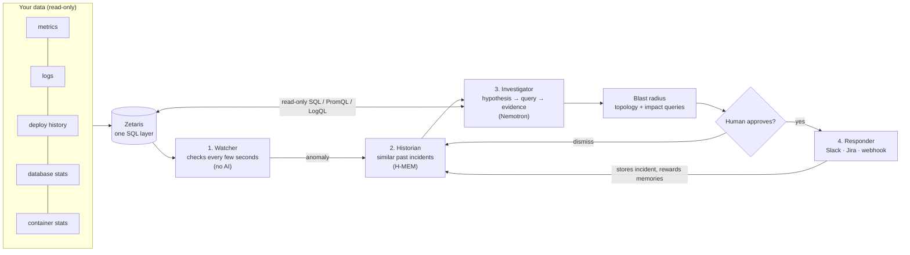

# Overwatch

**An AI on-call team for your software.** Overwatch watches a running system, notices when something breaks, works out *why* by querying your data the way an engineer would, shows its evidence, and, after a human approves, reports it to Slack and Jira.

Monitoring tools tell you *that* something is wrong. Overwatch tells you **what broke, why, what it is costing, and what to do about it**, with the queries that prove it.

Built for **HackOS 2026**, Track 02: *The Agent That Can Explain Why*.

## Contents

1. [What it does](#1-what-it-does)
2. [How it works](#2-how-it-works)
3. [Sponsor technology](#3-sponsor-technology)
4. [Quick start: the demo](#4-quick-start-the-demo)
5. [Using Overwatch on your own system](#5-using-overwatch-on-your-own-system)
6. [The demo system and its faults](#6-the-demo-system-and-its-faults)
7. [Testing and results](#7-testing-and-results)
8. [Security model](#8-security-model)
9. [Repository layout](#9-repository-layout)
10. [Pre-existing code and licenses](#10-pre-existing-code-and-licenses)

The full configuration, CLI, HTTP API, incident lifecycle, extension guide and troubleshooting are in [`docs/REFERENCE.md`](docs/REFERENCE.md).

---

## 1. What it does

When production breaks, an on-call engineer gets an alert like *"checkout error rate above 5%"* and then spends half an hour jumping between dashboards, logs, deploy history, database statistics and old tickets. Most of that is a mechanical loop (form a hypothesis, run a query, read the result, refine), which an AI agent can do **if** it has the right data, strict safety limits and a human in charge of every outgoing action.

1. **Watches** your signals every few seconds and alerts when a value crosses a limit, rises far above its own normal, or stops reporting.
2. **Remembers** past incidents (Meterless **H-MEM**) and recalls similar ones when something breaks.
3. **Investigates:** an AI model (**NVIDIA Nemotron**) forms hypotheses and tests them with read-only queries against your data until it can name the root cause with evidence.
4. **Measures the blast radius:** what is affected or at risk, when it started, how fast it was caught, what it is costing.
5. **Waits for you.** Nothing is sent until a human clicks *Approve*. Then it posts to Slack, opens a Jira ticket and teaches its memory.
6. **Notices recovery** on its own.

Everything is visible live in a web console with an interactive map of your system. Services that call a failing one are marked **at risk** the moment an incident opens, before any diagnosis exists.

**Real example** (this project's own testing, `nvidia/nemotron-3-ultra-550b-a55b`): after a release silently dropped a database index, Overwatch ran 7 queries and concluded, at 98% confidence:

> *"The orders service deploy v1.8.0 dropped the index on orders.customer_id. Without this index, queries do sequential scans on 3M rows, causing latency to spike from ~4ms to ~9s, exceeding the gateway's 1s timeout and triggering 100% error rate on /checkout."*
>
> Recommended fix #1: `CREATE INDEX orders_customer_id_idx ON orders (customer_id);`

---

## 2. How it works



| Agent | What it does | Uses AI? | Powered by |
|---|---|---|---|
| **Watcher** | Runs every check on an interval; fires on a fixed limit, a multiple of the check's own normal, missing data or a failed heartbeat. Opens incidents and merges related alerts into one. | No: plain arithmetic | Your data sources |
| **Historian** | Looks up past incidents with similar symptoms and hands them to the Investigator as hints. | No (retrieval) | **Meterless H-MEM** |
| **Investigator** | Think, pick one read-only query, read the result, repeat, within a step budget. Concludes with root cause, confidence, severity, the service where the cause lives, and fixes. | Yes | **NVIDIA Nemotron** |
| **Responder** | After approval: sends the report, stores the incident in memory, and rewards the memories that helped. On dismiss: sends nothing and penalizes memories that misled. | No | Slack, Jira, webhooks |

**When something breaks:**

1. A check crosses its limit. If an incident opened in the last few minutes is still open, the alert joins it (one cascade, one incident); otherwise a new one opens.
2. An **evidence pack** of standard queries runs in parallel, Overwatch computes the **incident timeline** (when it started, each signal's normal vs now, ranked suspects), the Historian recalls similar incidents, and a fast model posts a **first guess** within seconds while the deep investigation continues.
3. The Investigator works in a loop, one JSON action at a time (`query`, then `conclude`). This works with any OpenAI-compatible provider, with or without native tool calling.
4. The conclusion must list the explanations it considered (confirmed or ruled out), quote its evidence, and say whether it agrees with the first guess. Overwatch **checks every quote and technical term against the data**: unverified quotes or unsupported claims cap the confidence (60%, or 70–80% when only an inferred term is unsupported), a suspect the timing argues against caps it at 50%, and a second reader (the critic) flags statements the data does not show.
5. Overwatch computes the blast radius and business impact, the console shows the diagnosis, and a human approves or dismisses it.
6. When every check behind the incident has stayed healthy for a while, it is marked **recovered**. A check that stayed healthy and then breaks again opens a new incident.

**Design principles:** read-only always (a single `SELECT`/`WITH` per query, row-capped, timed out, in a read-only transaction); human in the loop; deterministic where possible (detection, start time, spread and impact are computed, not guessed); every conclusion cites the queries behind it; nothing in `overwatch/` knows about the demo.

---

## 3. Sponsor technology

| Technology | Requirement | How Overwatch uses it | Where to see it |
|---|---|---|---|
| **Zetaris** | Data layer | Overwatch's own data layer. When a user connects a database, Overwatch registers it as a Zetaris datasource and the Investigator queries only Zetaris (`<datasource>.<table>`, Spark SQL), so one query can join tables from different systems. Prometheus (`promql`), Loki (`logql`), Docker telemetry and Overwatch's own history go through it too. See [the data layer](#the-data-layer-zetaris). | `overwatch/datalayer.py`, `overwatch/sources/zetaris.py`; every query tagged *via Zetaris* in the console |
| **Meterless H-MEM** (engine) | At least one engine in a working feature | Incident memory. Approved incidents are stored with provenance and confidence; approval or dismissal becomes `helpful` / `not_helpful` feedback that changes confidence; every change is written to a trust ledger. **Official conformance suite: 13/13.** The recall-use-feedback-store loop is run live in [`eval/hmem-recall-test.md`](eval/hmem-recall-test.md). | `memory-service/`, [`eval/hmem-conformance.md`](eval/hmem-conformance.md), *Under the hood → Memory* |
| **Meterless Runtime / Nightshift** (provider) | Primary AI provider | Every model call goes through one OpenAI-compatible client (`overwatch/llm.py`) built to Meterless Runtime's documented contract: `meterless-app` / `meterless-scope` headers, the bearer token from `proxy-token`, `meterless/*` model ids, URL normalization, and a 180 s timeout. It is tested against a stand-in for Runtime (`tests/test_settings.py`), because no Linux x86_64 Runtime exists; the real model calls in this project went to NVIDIA's hosted API. Each call is logged to `traces/llm_calls.jsonl`. | `.env` (`LLM_BASE_URL`), *Under the hood → AI calls* |
| **NVIDIA Nemotron** | Model | Powers the Investigator's reasoning (`nvidia/nemotron-3-ultra-550b-a55b`) and a fast model gives the first guess (`nvidia/nemotron-3.5-lightning-30b-a3b`). | The console header (*AI*) |

> Nightshift's current build targets NVIDIA DGX Spark (ARM64) and there is no Ubuntu x86_64 installer, so the Investigator was tested against NVIDIA's hosted API directly. Meterless confirmed that integrating Meterless Runtime as a provider and testing with NVIDIA's hosted API satisfies the requirement. Switching to Nightshift is a two-line change in `.env` (see [`docs/REFERENCE.md`](docs/REFERENCE.md#using-nightshift-from-another-machine)).

---

## 4. Quick start: the demo

About 15 minutes once Zetaris is installed. Installing Zetaris is the long part (a 4 GB download and a 5 to 10 minute first start), so start it first.

You do not need a system of your own to try Overwatch: this quick start runs a bundled demo shop (`examples/demo-system/`) that you can break on purpose with one command, and Overwatch diagnoses it.

| Tool | Version | Used for |
|---|---|---|
| Python | 3.11+ | Overwatch itself |
| Java runtime | 11+ | Overwatch's JDBC connection to Zetaris |
| Node.js | 20+ | The H-MEM memory service |
| Docker + Compose | recent | Zetaris, Overwatch's own database, the demo shop |
| Zetaris | 2.4.x | The data layer (from the Zetaris Cloud "Run locally" page; four containers) |
| An AI provider | | Meterless Nightshift, or a free NVIDIA API key from https://build.nvidia.com |

**1. Install**

```bash
git clone git@github.com:samuel025/overwatch.git && cd overwatch
python3 -m venv .venv && . .venv/bin/activate
pip install -e ".[dev,zetaris]"          # the zetaris extra is the Java bridge
(cd memory-service && npm install)
```

The console is already built into `overwatch/ui/dist`.

**2. Configure secrets**

```bash
cp .env.example .env
```

Edit `.env` (git-ignored):

```dotenv
LLM_BASE_URL=https://integrate.api.nvidia.com/v1       # or Nightshift's http://127.0.0.1:8088/v1
LLM_API_KEY=nvapi-...                                  # from build.nvidia.com
OVERWATCH_MODEL=nvidia/nemotron-3-ultra-550b-a55b
OVERWATCH_TOKEN=pick-a-console-password                # optional, locks the console
ZETARIS_DRIVER_JAR=/path/to/zetaris-platform/jdbc/ndp-jdbc-driver-<version>-driver.jar
ZETARIS_USER=admin@zetaris.com
ZETARIS_PASSWORD=...
ZETARIS_HOST_ALIAS=172.17.0.1                          # Linux; host.docker.internal on macOS/Windows
```

`ZETARIS_HOST_ALIAS` is what "localhost" means to Zetaris, which runs in Docker. If you get `404 ... Not found for account`, that Nemotron model is not enabled for your NVIDIA account: pick another from `curl https://integrate.api.nvidia.com/v1/models`.

**3. Start Zetaris and Overwatch's own database**

```bash
cd zetaris-platform && docker compose up -d && ./verify.sh && cd -      # 5-10 minutes the first time
docker compose -f deploy/docker-compose.yml up -d                        # Overwatch's history and container telemetry
```

**4. Start the demo shop**

```bash
cd examples/demo-system && docker compose up -d --build    # about a minute: Postgres loads 3M orders
```

**5. Start the memory service and seed past incidents** (second terminal)

```bash
cd memory-service && npm start                             # H-MEM on http://127.0.0.1:8099
cd examples/demo-system && ../../.venv/bin/python scripts/seed_memory.py
```

**6. Connect Overwatch to Zetaris and check**

```bash
cd examples/demo-system
../../.venv/bin/python scripts/register_zetaris.py         # registers the demo databases in Zetaris (safe to repeat)
../../.venv/bin/python scripts/make_zetaris_config.py      # writes overwatch.zetaris.yaml
../../.venv/bin/overwatch -c overwatch.zetaris.yaml doctor # every line should say [ok]
```

No Zetaris yet? `overwatch.yaml` is the same demo in a plain development mode with direct database sources: use `-c overwatch.yaml` and skip the Zetaris parts. It exists for development, not as the product.

**7. Start Overwatch and open the console**

```bash
../../.venv/bin/overwatch -c overwatch.zetaris.yaml run
```

Open **http://127.0.0.1:8080** (with `?token=<your token>` once, if you set one). You should see *"All systems normal"* and a map of five green services. Give it two or three minutes of calm before breaking something.

**8. Break something and watch**

```bash
cd examples/demo-system
../../.venv/bin/python scripts/inject_fault.py slow_query    # break it
../../.venv/bin/python scripts/inject_fault.py reset         # fix it
```

Within ~30 seconds the banner turns amber and `orders` and `gateway` go red on the map; in a minute or two the diagnosis appears with an *Approve & send report* button. About a minute after the reset, the incident turns green: *Recovered*. `scripts/tour.py` shows several faults in a row.

You can also describe a problem yourself: type something like `checkout feels slow` or `payments are failing` into the **Report a problem** box at the top of the console and click **Investigate**. Overwatch investigates it the same way, without waiting for a check to fire.

**The console:** a live map of your system (drag the services; positions are remembered), the four agents' status, every signal with a sparkline, and the incident view: *What happened*, *Why* (with confidence), *Impact*, *What to do*, the explanations considered, the evidence relied on, and *How Overwatch figured it out* (each step with its query and result rows). *Under the hood* shows the data sources, memory and AI calls. **Settings** edits the configuration without a restart.

---

## 5. Using Overwatch on your own system

Overwatch does not plug into your services. It reads the data they already produce, read-only, and you describe your system once.

### Connecting: three ways

**1. The setup page (easiest).** Run `overwatch run` in a folder with no config and the console opens on *Connect your system*:

1. **Connect:** where your services run (Docker Compose is detected automatically; or a Kubernetes cluster, with its CA file or, as a last resort, a switch to skip certificate checks; and/or Loki for logs), optionally Prometheus, a trace store (Grafana Tempo or Jaeger) and databases, and your AI provider with **Test connection**.
2. **Review system:** a map of what was found, the external services it spotted, and a sentence per service. **Draft with AI** writes a first version of every empty description from facts Overwatch already holds (images, who calls whom, check names). It sends no secrets, never overwrites your words, names well-known software only when its image says so (anything else is described by its place in the system), and tags drafts *AI draft: check it* until you edit them.
3. **Checks & alerts:** the proposed checks with a reason for each, notifications, timings, and a preview of the file it will write. **Save and start watching** starts immediately.

**2. One command:**

```bash
overwatch connect --docker --project my-shop \
                  --prometheus http://prometheus:9090 \
                  --database ops=postgresql://readonly:password@db:5432/ops
overwatch doctor          # every line should say [ok]
overwatch run
```

**3. By hand:** `overwatch init` writes a commented starter file; see the [configuration reference](docs/REFERENCE.md#configuration-reference).

Discovery reads Docker/Compose (services, who calls whom, health endpoints), Kubernetes (services from pod labels), Loki (services and an error-rate check each), Tempo or Jaeger (services, call graph, latency and error checks per service), Prometheus (standard request metrics) and SQL databases (tables, change logs, logs, metrics). Latency checks compare each service to its own normal, so nobody has to guess a threshold. Secrets go into `.env`, never into `overwatch.yaml`. [What discovery finds](docs/REFERENCE.md#what-discovery-finds) has the details.

### What data it needs

| Data | Lets Overwatch… | Typical home |
|---|---|---|
| Per-service metrics (latency, errors, request rate) | detect problems; see which service is failing | Prometheus, a metrics table |
| Application logs | read the actual error messages | Docker or Kubernetes logs, Loki, a logs table |
| Deploy and config change history | connect a problem to the change that caused it | CI/CD, a `deploys` table |
| Database statistics (`pg_stat_activity`, `pg_stat_statements`, `pg_locks`, `pg_indexes`) | find slow queries, locks, missing indexes, connection problems | the database itself |
| Container metrics (CPU, memory, restarts, OOM kills) | find leaks, crashes, saturation | Kubernetes, Docker |
| Distributed traces (OpenTelemetry) | see where one slow or failing request spent its time, which span failed first, and repeated calls (N+1) | Grafana Tempo, Jaeger |
| Past incident tickets | give the Historian something to remember | Jira export |

The more you connect, the better the investigations. You do not need a logs table or a metrics table: Docker, Kubernetes, Loki and traces are read from their own APIs.

### Issues it can detect and explain

**Detected on their own** (checks discovery writes, or that you add):

| Issue | How it is seen |
|---|---|
| A service stopped, crashed, killed or paused | its container is not running, or its health URL or heartbeat goes silent |
| A service returning errors, or slow | error rate or p95 latency above its limit or far above its own baseline |
| A database connection pool nearly full | Postgres connections above 85% of `max_connections` (`<db>_connections_used_pct`) |
| A slow or stuck database query | the longest query running right now, over 5 s (`<db>_longest_query_seconds`) |
| A database down or unreachable | its container check fails and its callers' errors rise |
| Memory leak, restart loop, OOM kills, traffic surge | repeated restarts; request rate far above baseline |
| A third party failing | errors on calls to an external host, found in the logs |
| Any number you can query | a `metric` check: a SQL, PromQL or LogQL query, a limit, a service |

**Found during the investigation:** a bad release or config change just before the start (deploy history lined up against the timeline); a dropped index or why a query is slow (`pg_indexes`, `pg_stat_statements`); a lock held by an idle session or a batch job hogging the database (`pg_stat_activity`, `pg_locks`); a wrong timeout or pool size; a retry storm or N+1 pattern; one bad replica; and the wrong suspect, a service that only looks guilty because it reports the error (the blast radius separates *cause*, *affected* and *at risk*).

### Postgres setup

Connecting Postgres needs nothing special to start. The setup page tests each feature below and tells you the exact fix for any that is missing.

| Feature | What it needs |
|---|---|
| Catalog, change, log and metric tables | the user can `SELECT` on them |
| Connection saturation warning; locks, indexes, scan statistics | nothing extra |
| Slow or stuck query warning, and the "who is connected, running what" evidence | a superuser, or `GRANT pg_read_all_stats TO overwatch;` |
| Which queries are slow, and how slow (`pg_stat_statements`) | start Postgres with `-c shared_preload_libraries=pg_stat_statements`, restart, then `CREATE EXTENSION pg_stat_statements;` |

A suitable account, read-only apart from statistics. The setup page warns, with this exact fix, if you connect with an account that can write:

```sql
CREATE ROLE overwatch LOGIN PASSWORD '...';
GRANT CONNECT ON DATABASE yourdb TO overwatch;
GRANT USAGE ON SCHEMA public TO overwatch;
GRANT SELECT ON ALL TABLES IN SCHEMA public TO overwatch;
GRANT pg_read_all_stats TO overwatch;
```

### The data layer: Zetaris

The user never configures Zetaris: they connect their systems on the setup page and Overwatch registers what it needs. From then on **every query the Investigator runs goes through Zetaris**.

| What the Investigator asks about | How it reaches Zetaris |
|---|---|
| The user's databases | Registered as Zetaris datasources over JDBC (`CREATE DATASOURCE`, `REGISTER DATASOURCE TABLES`), queried as `<name>.<table>` in Spark SQL |
| Overwatch's own history: changes, incidents, every check's value | Overwatch's Postgres (`OVERWATCH_STATE_URL`), registered as datasource `overwatch` |
| Docker containers: state, events, log lines | A bounded window is mirrored into that same Postgres (`overwatch.container_state`, `container_events`, `container_logs`) |
| Prometheus and Loki | The Investigator writes `promql <expression>` or `logql <expression>`; Overwatch turns it into a Zetaris REST table plus a flattening view |

So one query can join "payments per minute before and after each deploy", or a container restart with the log lines around it. The Watcher keeps a fast direct path for checks (monitoring should not depend on a heavier path); the Investigator is offered only Zetaris, including live Postgres internals such as `pg_stat_activity` and `pg_locks`, which reach it as Zetaris views (`<db>.live_sessions`, `<db>.live_locks`). Kubernetes and traces stay live API sources. Zetaris is reached over JDBC with its own driver (Java and the `zetaris` extra); only Overwatch's setup and startup run DDL, and agents can only run `SELECT`, `WITH`, `SHOW`, `DESCRIBE` and the `promql`/`logql` commands. Without the `ZETARIS_*` variables Overwatch starts in a `direct` development mode.

**A semantic layer on top (the `usl` views).** At startup Overwatch also builds a Unified Semantic Layer in Zetaris: a SchemaStore container `usl` with business-named views, `usl.check_health`, `usl.container_status`, `usl.quality_results`, `usl.incident_history`, `usl.change_impact` (a release against what its service's checks did next), and `usl.target_status`, which joins Prometheus's live targets (through `promql`) with Docker container state from Overwatch's history in one statement. The Investigator is told to try them first. Live Postgres sessions and locks reach Zetaris the same way, as `<db>.live_sessions` and `<db>.live_locks` datasource views, so the Investigator's queries all go through Zetaris. It also compiles a governed Zetaris USL, `incident_response` (tables `service`, `incident`, `change_event`, with keys), which shows under Unified Semantic Layer in the Zetaris UI. The DDL is in `overwatch/datalayer.py` (`usl_statements`, `usl_object_statements`, `LIVE_VIEWS`).

**Data quality rules.** Discovery turns column names into rules that count rows breaking them (a count, amount or price below zero; an `expires_at` or `updated_at` earlier than `created_at`). They run through Zetaris every 5 minutes in the background, show in the console as checks named `dq_*`, open an incident when a row breaks one, and their latest results are in `usl.quality_results`. One Zetaris fault is worked around: version 2.4.3 returns every row for a `WHERE` that compares two columns, so the rules count with `CASE` inside an aggregate, and the Investigator is told not to write that `WHERE`.

---

## 6. The demo system and its faults

`examples/demo-system/` is a small online shop built to be broken on purpose: a gateway, an orders service (3M rows), two payments replicas, Postgres, a container-metrics collector, a "chaos" service (the outside world, including the card processor) and a load generator at ~15 checkouts per second. Overwatch does not depend on it.

Traces are optional: `DEMO_OTLP_ENDPOINT=http://tempo:4318 docker compose --profile tracing up -d --build` makes the shop emit OpenTelemetry traces to Tempo, then `python scripts/make_traces_config.py` writes `overwatch.traces.yaml` (run it with `overwatch -c overwatch.traces.yaml run`). The demo's Postgres ports are 15432 (shop) and 15433 (Overwatch state).

Each fault records its true cause and the keywords a correct diagnosis must mention, so the benchmark can grade Overwatch automatically.

| Fault | What really happens |
|---|---|
| `slow_query` | orders v1.8.0 drops the `customer_id` index; errors appear in the gateway, not orders |
| `bad_deploy` | payments v2.3.0 fails 35% of payments |
| `pool_exhaustion` | a config change shrinks the payments DB pool to 2 |
| `downstream_timeout` | payments gets 1.5 s slower; no deploy to blame |
| `red_herring` | the same, plus an innocent gateway release at the same moment |
| `lock_contention` | an `inventory-sync` session holds a table lock, idle in transaction |
| `config_timeout` | gateway→orders timeout set to 4 ms; orders is healthy but gets blamed |
| `retry_storm` | payments fails and gateway v3.2.0 retries multiply the load |
| `n_plus_one` | orders v1.9.0 runs one query per order |
| `report_job` | a batch report in business hours saturates the database CPU |
| `flash_sale` | a real traffic surge (~4×): the right answer is "scale", not "roll back" |
| `memory_leak` | orders v1.9.1 leaks memory and is OOM-killed every minute |
| `database_down` | Postgres is down, so Overwatch's own data sources fail |
| `double_trouble` | an index dropped AND a bad payments release |
| `service_down` | the orders service stops and goes silent |
| `bad_replica` | one of two payments instances fails everything |
| `connection_leak` | payments v2.4.0 never returns DB connections: a trend, not a step |
| `provider_rate_limit` | the card processor answers 429 to 40% of charges |
| `cert_expired` | TLS to the card processor fails: certificate expired |

```bash
cd examples/demo-system/scripts
python inject_fault.py list | show <fault> | <fault> | reset     # the catalog, ground truth, break it, fix everything
python tour.py slow_query cert_expired --pause 90               # live tour: break, wait for the diagnosis, fix
python verify_faults.py                                         # proves every fault is detected (no AI needed)
```

---

## 7. Testing and results

```bash
pytest                                       # 225 offline tests: no database, AI or memory service needed
cd memory-service && npm run conformance     # the official H-MEM conformance suite
PYTHON=.venv/bin/python scripts/k8s-smoke/run.sh   # real k3d cluster + real Loki (needs docker, k3d, kubectl)
python eval/run_eval.py                      # the benchmark: every fault, memory on and off, graded against ground truth
```

| What | Result | Evidence |
|---|---|---|
| H-MEM conformance | **13/13** | [`eval/hmem-conformance.md`](eval/hmem-conformance.md) |
| H-MEM in the loop, run live | past incidents recalled, one used in the diagnosis, a new memory stored, the helpful one rewarded | [`eval/hmem-recall-test.md`](eval/hmem-recall-test.md) |
| Detection: does the Watcher catch every fault? | **18/18** with a healthy baseline before each injection | [`eval/fault-verification.md`](eval/fault-verification.md) |
| Diagnosis with a real model (Nemotron) | `slow_query` correct three times (up to 98%); `service_down`, `lock_contention`, `bad_deploy` and `config_timeout` correct; a live URL-shortener app (killed and paused Postgres, killed Redis, connection exhaustion, slow queries) diagnosed correctly | spot checks during development |
| Kubernetes, run live | discovery found all services; the crash-looping worker was diagnosed correctly from its logs, pods and events | `scripts/k8s-smoke/run.sh` |
| Distributed traces, run live (Tempo and Jaeger) | the instrumented demo shop's real traces were read; with an N+1 fault it named the N+1 and cited the trace rows (one run; not faster, and a slow query was diagnosed correctly with or without traces) | `examples/demo-system/tracing/` |
| Loki through Zetaris, run live | `logql` queries and Overwatch's history joined in one investigation, diagnosed correctly | [`eval/loki-through-zetaris.md`](eval/loki-through-zetaris.md) |

---

## 8. Security model

| Concern | What Overwatch does |
|---|---|
| Agents changing your systems | A query must be a single `SELECT`/`WITH`; writes, DDL and multiple statements are rejected before they reach the database; Postgres queries run in a read-only transaction with a statement timeout; results are capped. The setup page warns if the database account can write. |
| Sending something wrong | Human approval by default. Failed or inconclusive investigations cannot be approved. Dismissals teach the memory. |
| Console access | Set `OVERWATCH_TOKEN`; the console and API then require it. `overwatch run` refuses to listen beyond localhost without a token unless `--insecure`. |
| Secrets | Only in environment variables / `.env` (git-ignored); config files reference them as `${VAR}`. |
| Data sent to the model | Query results (capped, clipped) go to the AI provider; with Nightshift running locally they stay on your hardware. Draft with AI sends no environment values or credentials. |
| Untrusted text | Logs and rows reach the model as data. Impact is limited by read-only access and human approval. |
| Memory service | Optional bearer token (`MEMORY_TOKEN`); listens on localhost by default. |

---

## 9. Repository layout

```
overwatch/                 the product (Python, system-agnostic)
  agents/                  watcher, historian, investigator, responder
  sources/                 sql, zetaris, prometheus, docker, kubernetes, loki, traces
  memory/                  H-MEM client (default), local and none
  notifiers/               console, slack, jira, webhook
  discovery/               docker, kubernetes, loki, traces, prometheus, sql discovery; renders overwatch.yaml + .env
  orchestrator.py          pipeline, incident lifecycle, blast radius, evidence pack, timeline
  grounding.py, suspects.py  check a conclusion against the data; rank the events before a problem
  drafting.py              Draft with AI for service descriptions
  llm.py                   the single place model calls happen (Meterless Runtime contract)
  server.py, cli.py        JSON API and server-sent events; the `overwatch` command
  ui/dist/                 the built console
web/                       console source (React, Vite, TypeScript)
memory-service/            H-MEM engine (TypeScript), HTTP server, conformance suite
examples/demo-system/      the demo shop, its config, fault scripts and tracing (Tempo)
scripts/k8s-smoke/         live Kubernetes and Loki smoke test
eval/                      benchmark runner and verification reports
docs/REFERENCE.md          configuration, CLI, HTTP API, lifecycle, extending, troubleshooting
tests/                     offline tests
PLAN.md                    hackathon plan and schedule
```

---

## 10. Pre-existing code and licenses

- `memory-service/src/hmem/` and `memory-service/conformance/` are vendored from the Meterless H-MEM reference implementation (Apache-2.0, https://github.com/Meterless/Meterless, commit `1742dec`). Overwatch's changes are listed in [`memory-service/src/hmem/NOTICE.md`](memory-service/src/hmem/NOTICE.md).
- Open-source libraries: FastAPI, Uvicorn, SQLAlchemy, psycopg, httpx, PyYAML, the OpenAI Python client, JayDeBeApi (the optional Zetaris bridge); React, Vite, React Flow (`@xyflow/react`), Sonner, NumberFlow, zustand, clsx; the IBM Plex Sans and JetBrains Mono fonts (Fontsource). The demo shop uses OpenTelemetry (SDK, OTLP exporter, FastAPI and httpx instrumentation); the tracing demo runs Grafana Tempo, and the tests use fixtures recorded from Tempo and Jaeger.
- Everything else was written during the HackOS 2026 build window.
