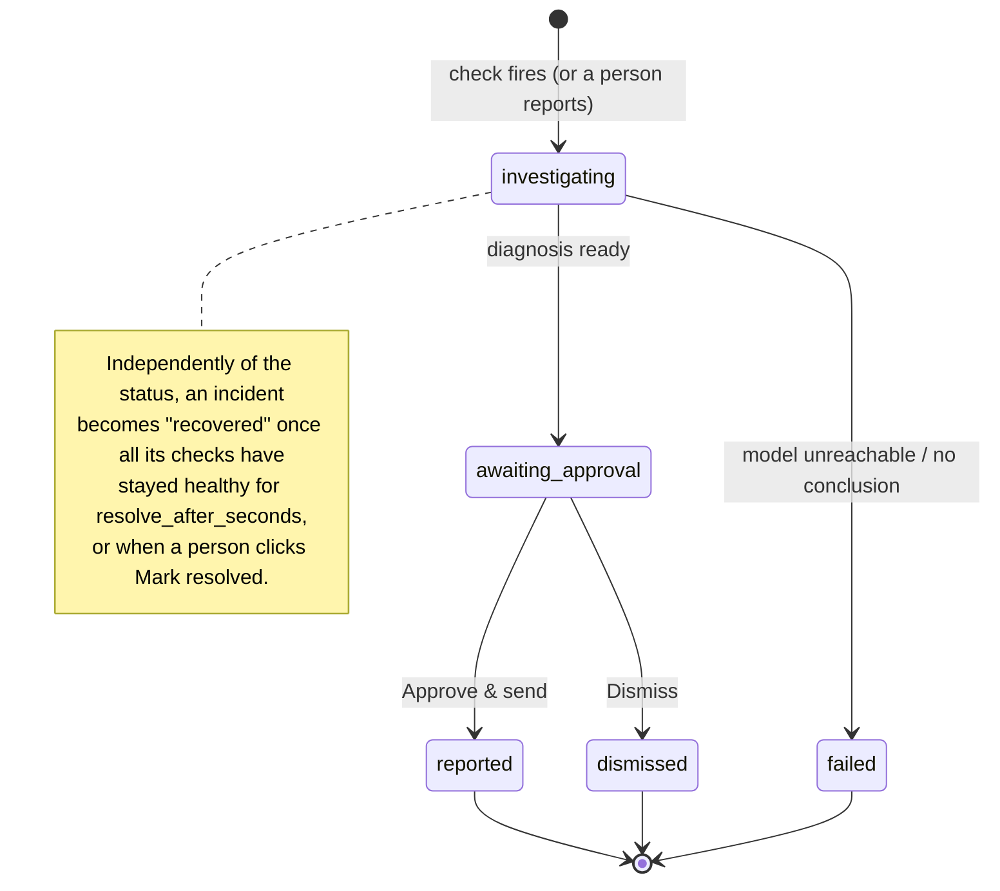

# Overwatch reference

The details behind the [README](../README.md): every configuration key, the console, the CLI, the HTTP API, the incident lifecycle, how to extend Overwatch, and troubleshooting.

- [Configuration reference](#configuration-reference)
- [What discovery finds, external services, built-in sources, writing a catalog](#what-discovery-finds)
- [The console](#the-console)
- [Command-line reference](#command-line-reference)
- [HTTP API reference](#http-api-reference)
- [The demo scripts](#demo-scripts-examplesdemo-systemscripts)
- [Incident lifecycle in detail](#incident-lifecycle-in-detail)
- [Extending Overwatch](#extending-overwatch)
- [Troubleshooting](#troubleshooting)

---

## Configuration reference

Overwatch reads one YAML file. `${VAR}` and `${VAR:-default}` are replaced from the environment; Overwatch also loads the nearest `.env` file at or above the config file's folder, and one in the current directory.

### `system`

```yaml
system:
  name: demo-shop
  description: >
    Who calls whom, timeouts, normal traffic levels, anything an engineer would tell a newcomer.
```

### `docker`: turn on the Docker features

```yaml
docker:
  project: my-shop              # Compose project; omit to watch every container
  service_label: com.docker.compose.service   # label that names the service (default)
  socket: /var/run/docker.sock
```

Adds the built-in `docker` data source, `kind: container` checks, the container-event listener, and container state/events in every evidence pack.

### `services` and `runtime_facts`: what a newcomer would be told

```yaml
services:
  orders:
    what: returns a customer's latest orders from shopdb.orders (3M rows)
    runs_on: one container, 0.5 CPU, 256 MB memory limit, restart policy unless-stopped
    normal: p95 about 10 ms, errors under 1%
    known_failures: without the customer_id index every lookup is a full scan
runtime_facts: |
  Everything runs on Docker Compose; there is no Kubernetes and no load balancer.
  Exit code 0 = clean stop, 137 = killed (usually out of memory), 143 = terminated.
```

Passed to the Investigator as facts. These two sections prevent the most common diagnosis mistakes (assuming infrastructure that does not exist, misreading exit codes). Any keys work under each service.

### `sources`: where the data lives

```yaml
sources:
  zetaris:                       # the data layer; written by setup from the deployment's environment
    type: zetaris
    jdbc_url: ${ZETARIS_JDBC_URL}
    driver_class: ${ZETARIS_DRIVER_CLASS}   # the class of the Zetaris JDBC driver you downloaded
    driver_jar: ${ZETARIS_DRIVER_JAR}
    username: ${ZETARIS_USER}
    password: ${ZETARIS_PASSWORD}
  appdb:
    type: postgres               # or "sql" for any SQLAlchemy database (MySQL, Snowflake, ...)
    url: postgresql+psycopg://readonly:${DB_PASSWORD}@db:5432/app
    max_rows: 50                 # rows returned to the model per query (default 50)
    timeout_seconds: 10          # per-query timeout (default 10)
  prom:
    type: prometheus             # Prometheus or compatible (VictoriaMetrics, Mimir, Thanos)
    url: http://prometheus:9090
    bearer_token: ${PROM_TOKEN}  # optional
  logs:
    type: loki                   # application logs, queried with LogQL
    url: http://loki:3100
    tenant: team-a               # optional (X-Scope-OrgID)
    since_minutes: 15            # window for log-line queries
  cluster:
    type: kubernetes             # pods, logs, events, rollouts straight from the API server
    # verify: /path/to/ca.crt    # the cluster's CA, if its certificate is not publicly signed (false skips the check)
    namespace: shop              # inside a cluster, the pod's service account and namespace are used
    # outside a cluster:  url: https://api.example.com:6443   token: ${K8S_TOKEN}
    service_label: app           # label naming a service (default: app.kubernetes.io/name, then app)
```

Kubernetes needs a service account that can `get`/`list` pods, `pods/log`, events and deployments in the namespace. Its commands are `pods`, `logs <service>`, `errors <service>`, `events [minutes]`, `rollouts` and `count <service|*> <minutes> <text>`, and `kind: container` checks work against it exactly as against Docker.

```yaml
  traces:
    type: traces                 # distributed traces from Grafana Tempo or Jaeger (OpenTelemetry)
    kind: tempo                  # or jaeger; detected from the URL when omitted
    url: http://tempo:3200
    tenant: team-a               # optional (X-Scope-OrgID)
    bearer_token: ${TRACES_TOKEN}
```

Commands: `slow <service> [min_ms] [minutes] [limit]`, `errors <service> [minutes] [limit]`, `trace <trace_id>` (spans with self time, share of the request, and the deepest failing span as the failure origin), `graph [minutes]` (call-graph edges), `hotspots <service> [minutes]` (the spans repeated most within one request, with repeats per request; about five or more suggests an N+1 pattern), `p95 <service> [minutes]`, `error_count <service> [minutes]` and `error_pct <service> [minutes]` (the failed share of the newest traces; fewer than 20 requests count as 20, so one unlucky request on a quiet service does not alert. The generated error check uses this, with a 5% threshold). Only allowlisted span attributes are read (method, route, status, db system and name, peer service, exception type); URLs lose their query strings. Traces stay a live source, not routed through Zetaris. The demo's Postgres ports default to 15432 and 15433.

Two sources are always available without configuration: `overwatch` (the built-in change log, SQLite, read-only) and, with a `docker:` section, `docker`.

### `catalog`

Free text describing every table, view and metric the Investigator may query. See [Writing a good catalog](#writing-a-good-catalog).

### `topology`: who calls whom

```yaml
topology:
  gateway: [orders, payments]
  orders: [postgres]
  payments: [postgres, psp.example.com]   # names containing a dot are shown as external
```

Used for the system map and the blast radius. Service names should match the `service` field of your checks so the map can colour each box. Discovery does this for you when Prometheus names a service differently from Docker (`url_shortener_api` versus `api`): the metrics are attached to the Docker service and a note says so.

### `checks`: what the Watcher evaluates

Each check is a query that returns one number (the first numeric column of the first row, or a column named `value`).

| Key | Default | Meaning |
|---|---|---|
| `name` | required | Unique id, e.g. `orders_p95_latency_ms` (the `_ms` / `_pct` / `rate` suffix sets the display unit) |
| `service` | `unknown` | Which service this check describes (matches `topology`) |
| `source` | required | Which entry of `sources` to query |
| `query` | required | Read-only query returning one number |
| `threshold` | — | Fixed limit |
| `comparison` | `>` | `>`, `>=`, `<`, `<=` |
| `relative_factor` | — | Also alert when the value exceeds this multiple of the check's own median over `baseline_minutes` (excluding the last 2 minutes). Needs ~10 samples of history first. |
| `relative_min` | `0` | …but only when the value is at least this (ignores noise on tiny baselines) |
| `baseline_minutes` | `30` | Window for the relative baseline |
| `no_data` | `ignore` | `alert`: a query that returns no value is itself an incident (the service went silent) |
| `kind` | `metric` | `heartbeat`: when this check fires, the service is shown as **Not responding**. `probe`: Overwatch calls `url` itself (no `source`/`query`). `container`: number of running Docker containers for `service` (needs `docker:`) |
| `url`, `timeout_ms` | — / `2000` | For `probe` checks: the health URL and its timeout |
| `every_seconds` | `0` | Run this check in the background at most this often and let the Watcher read its last result (data quality rules use `300`), so a slow query never holds up the pass |
| `description` | `""` | Human description shown in alerts and reports |
| `severity` | `medium` | `low`, `medium`, `high`, `critical` |

A check needs a `threshold`, a `relative_factor`, or both.

**Data quality rules.** With a database connected, discovery adds checks named `dq_<table>_<rule>` that count the rows breaking a rule (`threshold: 0`, `every_seconds: 300`): a column named like a count, amount, quantity, price or balance that goes below zero, and a timestamp such as `expires_at` or `updated_at` earlier than `created_at`. Tables over 5 million rows are checked on the last day's rows only. They count with `sum(CASE WHEN ... THEN 1 ELSE 0 END)`, not a `WHERE` comparing two columns, because Zetaris 2.4.3 returns every row for that. Turn one off like any check on the settings page.

**The semantic layer.** With Zetaris as the data layer, Overwatch creates the SchemaStore container `usl` at startup (in the background, safe to repeat): `usl.check_health` (each check's average, maximum and share of time failing), `usl.container_status` (the newest row per container), `usl.quality_results` (the latest result of each `dq_*` rule), `usl.incident_history` (every incident Overwatch has handled: cause, severity, confidence, how many quotes were verified), `usl.change_impact` (each release or config change with what its service's checks did in the 15 minutes after it) and, with Prometheus connected, `usl.target_status` (Prometheus targets joined with container state). Code: `usl_statements` and `create_usl` in `overwatch/datalayer.py`.

**The governed model.** Overwatch also compiles a Zetaris Unified Semantic Layer, the object that appears under Data Product > Unified Semantic Layer in the Zetaris UI: `lightning.metastore.overwatch.incident_response`, with tables `service`, `incident` and `change_event`, primary and foreign keys (a change must point at a known service, which Zetaris turns into a data quality rule), and descriptions. Each table is activated with a SELECT over Overwatch's history, so it stays live. Query it as `lightning.metastore.overwatch.incident_response.<table>`. Code: `usl_object_statements` in `overwatch/datalayer.py`.

**Live Postgres internals, through Zetaris.** Registering a database brings in its tables, not `pg_stat_activity` or `pg_locks`. For each registered PostgreSQL database Overwatch also creates three Zetaris datasource views, which run inside that database and add nothing to its schema: `<db>.live_sessions` (who is connected, what they run or wait on, and which pids block them), `<db>.live_locks` (current table locks; `granted = false` is a waiter) and `<db>.live_table_stats` (sequential and index scans, dead rows). The Investigator reads them like any table, so every query it writes goes through Zetaris. The direct Postgres connection (`<db>_live`) is marked `internal` and serves the Watcher's connection and slow-query checks only. Code: `LIVE_VIEWS` in `overwatch/datalayer.py`.

Example heartbeat (liveness from container state, not from traffic):

```yaml
- name: orders_heartbeat
  kind: heartbeat
  service: orders
  source: opsdb
  query: >
    SELECT count(*) AS value FROM container_metrics
    WHERE service = 'orders' AND status = 'running' AND ts > now() - interval '30 seconds'
  comparison: "<"
  threshold: 1
  description: no running orders container in the last 30s
```

> Base heartbeats on **liveness** (is the process running?), not on traffic. A service that is healthy but receives no requests because something upstream broke would otherwise look dead.

### `evidence`: the evidence pack

```yaml
evidence:
  - name: top_errors
    label: Top error messages in the last 5 minutes
    source: opsdb
    query: >
      SELECT service, left(message, 160) AS message, count(*) AS n FROM app_logs
      WHERE level = 'ERROR' AND ts > now() - interval '5 minutes' GROUP BY 1, 2 ORDER BY n DESC LIMIT 10
```

Run in parallel the moment an incident opens (well under a second) and handed to the Investigator, so it starts from the basics instead of spending its first steps fetching them. Timestamped rows are labelled with `minutes_before_start`. Recent changes from the built-in change log, and container state/events (with `docker:`), are always included.

### `changes`: learn about deploys without being told

Instead of asking CI to push every release to `/api/changes`, Overwatch can poll where changes already happen. Each change is stored once, with the time it really happened, in the same change log the Investigator reads ("what changed just before this?").

```yaml
changes:
  - type: github                 # releases, GitHub deployments and, optionally, successful deploy workflow runs
    repo: acme/payments
    token: ${GITHUB_TOKEN}       # read access to the repo; stays in .env
    service: payments            # which service a change belongs to (default: the repo name)
    events: [releases, deployments, workflow_runs]   # default: releases and deployments
    environment: production      # optional: only deployments to this environment
    workflow: deploy.yml         # for workflow_runs
    branch: main                 # optional
    interval_seconds: 60         # default 60
    lookback_minutes: 120        # ignore changes older than this (default 120)
  - type: kubernetes             # a Deployment whose image changed is a deploy; a spec change is a config change
```

Discovery adds the `kubernetes` feed automatically when it finds a cluster. A feed that fails (bad token, GitHub down) shows up as an error event and never affects watching. One repository maps to one service, so a monorepo needs one entry per service.

### `events`: pushed event streams

```yaml
events:
  - type: docker
    service_label: com.docker.compose.service
    filters: {label: ["com.docker.compose.project=my-shop"]}
```

Implied by a `docker:` section. A dead container shows as **Not responding** on the map at once; an incident opens only if it stays down past `watch.event_grace_seconds`, so routine restarts page nobody.

### `impact`: business cost of an incident

```yaml
impact:
  - name: failed_checkouts
    label: Failed checkouts
    source: opsdb
    unit: ""                     # "USD" renders as currency
    query: >
      SELECT coalesce(sum(requests * error_rate), 0) AS value FROM request_metrics
      WHERE service = 'gateway' AND ts >= {since}
```

`{since}` is replaced with the incident's start time as a timestamp literal. Measured when the diagnosis is ready and again on approval.

### `watch`: timing and incident lifecycle

| Key | Default | Meaning |
|---|---|---|
| `interval_seconds` | `30` | How often the Watcher runs every check |
| `cooldown_seconds` | `600` | A flapping check cannot open a new incident again within this window. A check that stayed healthy for the whole recovery period first is a new problem and is not held back |
| `merge_window_seconds` | `300` | New alerts join an incident opened this recently instead of opening another |
| `resolve_after_seconds` | `60` | An incident recovers once all its checks stay healthy this long |
| `max_parallel_investigations` | `2` | Worker pool size |
| `confirm_samples` | `2` | A breach must hold this many passes in a row to open an incident; the first bad pass shows as **Possible problem** |
| `event_grace_seconds` | `8` | A container back up within this time was a restart, not an outage |

### `llm`: the AI provider

```yaml
llm:
  base_url: ${LLM_BASE_URL:-http://127.0.0.1:8088/v1}   # Nightshift default
  api_key: ${LLM_API_KEY}            # or token_file: ~/.../proxy-token
  investigator_model: ${OVERWATCH_MODEL:-meterless/text.deep}
  temperature: 0.1
  max_steps: 8                       # query budget per investigation
  triage_model: ${OVERWATCH_TRIAGE_MODEL:-meterless/text.fast}   # fast first guess (optional)
  triage_extra_body:                 # provider options for the fast model, e.g. no long reasoning
    chat_template_kwargs: {enable_thinking: false}
  headers: {}                        # extra headers, if your provider needs any
```

The **fast first guess** answers in seconds from the evidence pack and is shown while the deep investigation runs; the deep investigation must then agree with it or say why not.

Any OpenAI-compatible endpoint works. Overwatch always sends `meterless-app: overwatch` and `meterless-scope: user` (required by Nightshift, harmless elsewhere) and uses a 180-second timeout because a cold model load can take minutes.

### `memory`

```yaml
memory:
  type: hmem                         # hmem (default) | local | none
  url: ${MEMORY_URL:-http://127.0.0.1:8099}
  token: ${MEMORY_TOKEN}             # if the memory service requires one
```

`local` is a dependency-free keyword-matching fallback stored in a JSONL file (`path:`); `none` disables memory (used as the "memory off" baseline in evaluation).

### `approval`, `notifiers`, `console`, storage

```yaml
approval: manual                     # manual | auto

notifiers:
  - type: console                    # prints the report
  - type: slack
    enabled: true
    webhook_url: ${SLACK_WEBHOOK_URL}           # Slack incoming webhook
  - type: jira
    enabled: true
    base_url: ${JIRA_BASE_URL}                  # https://your-site.atlassian.net
    email: ${JIRA_EMAIL}
    api_token: ${JIRA_API_TOKEN}
    project_key: OPS
    issue_type: Bug
    set_priority: false                         # map severity to Jira priority
  - type: webhook
    url: https://example.internal/hook          # receives the full incident as JSON
    headers: {}

console:
  token: ${OVERWATCH_TOKEN}          # locks the console and API when set

trace_dir: traces                    # traces, investigation logs
state_path: ""                       # SQLite incident store; default <trace_dir>/overwatch.db
state_url: ""                        # or a Postgres URL (env OVERWATCH_STATE_URL): Overwatch's own history in a real database
```

### Environment variables

| Variable | Used for |
|---|---|
| `LLM_BASE_URL`, `LLM_API_KEY`, `OVERWATCH_MODEL`, `OVERWATCH_TRIAGE_MODEL` | AI provider (Nightshift or NVIDIA) |
| `OW_<SOURCE>_URL` | Database addresses written by discovery |
| `OVERWATCH_STATE_URL` | Postgres URL for Overwatch's own history (change log, incidents, check history); default is a SQLite file |
| `MEMORY_URL`, `MEMORY_TOKEN` | H-MEM service |
| `OVERWATCH_TOKEN` | Console/API token |
| `ZETARIS_JDBC_URL`, `ZETARIS_DRIVER_CLASS`, `ZETARIS_DRIVER_JAR`, `ZETARIS_USER`, `ZETARIS_PASSWORD` | The deployment's Zetaris workspace (the data layer); end users never set these |
| `GITHUB_TOKEN` | Change feed (`changes:`), read access to the repo |
| `SLACK_WEBHOOK_URL`, `JIRA_BASE_URL`, `JIRA_EMAIL`, `JIRA_API_TOKEN` | Notifiers |
| `HMEM_DIR`, `PORT`, `HOST`, `MEMORY_TOKEN` | Memory service (`memory-service/`) |

### Using Nightshift from another machine

Nightshift runs on Windows (with a dedicated GPU), Apple Silicon Macs and DGX Spark, not Linux. To use it from a Linux machine:

1. On the Nightshift machine: install Nightshift, add NVIDIA as a provider and pick a Nemotron model, turn on **hotspot mode**, and copy the token from its `proxy-token` file.
2. If the machines are not on the same network, connect them with **Tailscale** (`curl -fsSL https://tailscale.com/install.sh | sh && sudo tailscale up` on Linux) and share the Nightshift machine. Do not expose it with port forwarding.
3. Test: `curl http://<ip>:8088/healthz`.
4. In `.env`:
   ```dotenv
   LLM_BASE_URL=http://<ip>:8088/v1
   LLM_API_KEY=<proxy-token contents>
   OVERWATCH_MODEL=meterless/text.deep
   ```
5. `overwatch -c overwatch.yaml doctor` → the AI provider line should say `[ok]` and list `meterless/...` routes.

---

## What discovery finds

| From | It discovers |
|---|---|
| **Docker / Docker Compose** | services (replicas grouped as one), **who calls whom** (Compose's `depends_on` labels), CPU and memory limits, restart policy, **health endpoints** (tries `/health`, `/healthz`, `/ready`, `/status` on published ports), and a liveness check per service |
| **Kubernetes** | services from pod labels, dependencies from environment values that name another service, readiness probes, a liveness check per service, hostnames of external services in env and error logs |
| **Loki** | services from its labels, an error-rate check per service (alerts at 4x its own normal), an error-volume evidence query |
| **SQL databases / Zetaris** | every table and column for the catalog; a **change log** (columns like `service` + `version` + a timestamp), **logs** (`level` + `message`) and **metrics** tables (`service` + latency/error columns), turned into per-service latency and error checks; the database's own health views (`pg_stat_activity`, `pg_stat_statements`...) |
| **Prometheus** | standard request metrics (`http_requests_total`, `http_request_duration_seconds`, OpenTelemetry names) and `up`, turned into per-service latency, error-rate and liveness checks |

Latency checks use **compare-to-normal** (4× the service's own recent median), so nobody has to guess a threshold. Database addresses with passwords and the AI key go into `.env`, never into `overwatch.yaml`.

---

## External services

Third-party APIs and managed services (a payment provider, email, a hosted database) are invisible to Docker, so discovery looks for two clues:

- **Your services' settings:** addresses in container environment variables (`PAYMENT_API_URL=https://api.stripe.com`, `SMTP_HOST=smtp.sendgrid.net`). Only the hostname is kept; the value (which can contain credentials) is never stored or shown. Your own containers, cluster-internal names and raw IPs are ignored.
- **Your error logs:** hosts named in recent errors (`POST https://psp.example.com/v1/charge returned 429`), from Docker logs or a logs table.

Each one is suggested with the evidence ("payments has it in the PROVIDER_URL setting") and the services that call it. On the setup page you can accept, rename or drop suggestions, add any that were missed, and give each one:

- **who calls it**: adds it to the topology, so the map and blast radius include it;
- **a health or status URL** (optional): becomes a probe, so Overwatch can tell "it's them" from "it's us";
- **text that appears in your error logs when it fails** (optional): becomes a check ("more than 5 such errors in 2 minutes") on the logs table, or on Docker logs (`count <callers> 2 <text>`).

In the demo shop, payments reaches the card processor through `PROVIDER_URL=http://psp.example.com:8000/psp`, so discovery finds `psp.example.com` on its own.

---

## Built in, no setup needed

- **Docker as a data source.** With a `docker:` section, the Investigator can ask Docker directly for container state, a service's recent **logs** (`logs orders 100`, `errors orders`) and recent **container events** (crashes, restarts, OOM kills): no log shipping required. Container deaths are also pushed to Overwatch the instant they happen.
- **Change log.** Overwatch keeps its own record of releases and config changes. Add one line to your release pipeline:
  ```bash
  overwatch change --service orders --version 2.4.0 --description "Release 2.4.0" --url http://overwatch:8080
  # or: curl -X POST http://overwatch:8080/api/changes -d '{"service":"orders","version":"2.4.0"}'
  ```
  It is queryable by the Investigator (built-in `overwatch` source, table `changes`) and part of every evidence pack.
- **Pushed alerts.** `POST /api/ingest` accepts alerts from any tool, including Prometheus Alertmanager webhooks.

Overwatch can run on any machine that can reach your data; it does not need to run next to your services. The memory service (`memory-service/`) must be running for `memory.type: hmem`.

---

## Writing a good catalog

The catalog is plain text that tells the Investigator what exists. It matters more than anything else for investigation quality: the model cannot use a table it does not know about. Include table names, columns with units, how often rows are written, and anything non-obvious:

```yaml
catalog: |
  zetaris:
    request_metrics(ts timestamptz, service text, instance text, p95_ms float, error_rate float)
      one row per instance every 10 seconds; error_rate is 0..1
    deploys(ts timestamptz, service text, version text, description text)
      every release and config change, all teams
    appdb.live_sessions, appdb.live_locks, appdb.live_table_stats: live Postgres internals (views Zetaris runs inside appdb)
```

---

## The console

`overwatch run` serves the console at http://127.0.0.1:8080. It updates live over server-sent events; there is no polling and no refresh needed.

### Layout

| Area | What it shows |
|---|---|
| **Header** | System name; the stack in use (*Data*, *Memory*, *AI*); a box to **report a problem** in plain words ("checkout feels slow") and have it investigated |
| **Status banner** | One sentence about right now: *All systems normal* · *Gateway error rate: investigating, step 3* · *Diagnosis ready: … 90% confidence, waiting for your approval* · *Overwatch can't read the monitoring data* |
| **Your system** (map) | Every service from `topology` as a live card with its state and key numbers. **Healthy** (green), **Having problems** (red), **Not responding** (grey, dashed), **No data** (no checks). During an incident: **Likely cause**, **Affected**, **At risk**, and the failing call paths in red |
| **Incident** | The current incident (or the one you picked) in four plain boxes: **What happened**, **Why** (with confidence), **Impact** (failed checkouts, revenue at risk, start, time to detect, duration), **What to do**. Then **Approve & send report** / **Dismiss**, **Mark resolved**, and *How Overwatch figured it out*: each step as a sentence, with the SQL and result rows one click away |
| **Agents** | What each agent is doing, in words |
| **Signals** | Every check grouped by service, with a sparkline and its alert line |
| **Incidents** | History. Clicking one pins it; **Back to live** follows new incidents again |
| **Diagnosis details** | The fast **first guess** while investigating; then the explanations considered with verdicts, the evidence quotes with ✓/⚠, and the **evidence check** ("6/6 quotes found in the data") |
| **Settings** (header button) | Edit the running configuration without re-running discovery: see [The settings page](#the-settings-page) |
| **Under the hood** | Data sources, H-MEM memories and trust ledger, and every AI call (agent, seconds, tokens, provider) |

### The settings page

The **Settings** button in the header opens a page with sections down the left. Every change is written to `overwatch.yaml` (secrets to `.env`) and applied live, with no restart. A bar at the bottom appears when you have unsaved changes (**Discard** / **Save and apply**), and the previous file is kept as `overwatch.yaml.bak-<time>`.

| Section | What you can change |
|---|---|
| **System & services** | The system description, and per service what it does and what normal looks like. **Draft with AI** fills the empty ones for you to check |
| **External services** | Add, rename, remove or switch off third-party APIs; which of your services call each; a health/status URL; the error text to watch for in logs. Hand-written checks are updated in place |
| **Checks** | Switch each check on or off; change its severity and limit |
| **AI provider** | Nightshift / NVIDIA presets or any OpenAI-compatible address, key, models, investigation steps, **Test connection** |
| **Notifications** | Slack, Jira, generic webhook (secrets go to `.env`; saved values show as "saved", never as text) |
| **Watching & approval** | Check interval, confirm passes, recovery and merge windows, cooldown, parallel investigations, manual or automatic sending |
| **Connections** | The data sources in use; **Run discovery again** to add a database, Prometheus, Kubernetes or Loki |

If the new configuration fails to load, the save is rejected with the reason and the old file is restored. Saving rewrites the YAML: the opening comment block is kept, comments further down are not (they remain in the backup). The page deep-links, e.g. `#settings/notify`.

### Building the console

The console source is a React + Vite app in `web/`, built into the Python package:

```bash
cd web
npm install
npm run build        # outputs ../overwatch/ui/dist, served by `overwatch run`
npm run dev          # hot reload on :5173, proxies /api to :8080
```

---

## Command-line reference

```
overwatch [-c CONFIG] [--memory {hmem,local,none}] <command>
```

| Command | What it does |
|---|---|
| `overwatch connect [--docker] [--project P] [--service-label L] [--prometheus URL] [--database NAME=URL]... [--print]` | Discover your system and write `overwatch.yaml` + `.env` |
| `overwatch change --service S [--version V] [--kind deploy\|config\|rollback\|infra] [--description D] [--url URL]` | Report a release or config change to a running Overwatch (for CI) |
| `overwatch init [path]` | Write a commented starter `overwatch.yaml` |
| `overwatch -c overwatch.yaml doctor` | Check every source, the AI provider, memory, each check, the impact queries and the topology. Exit code 1 if anything fails |
| `overwatch -c overwatch.yaml check [-y]` | One Watcher pass; if anything fires, investigate it in the foreground and ask whether to approve (`-y` approves) |
| `overwatch -c overwatch.yaml investigate "<symptom>" [--service NAME] [-y]` | Investigate a described problem |
| `overwatch -c overwatch.yaml run [--host H] [--port P] [--insecure]` | Watch continuously and serve the console. With no config yet, opens the setup page. Refuses a non-local `--host` without a console token unless `--insecure` |

`--memory` overrides the memory backend for one run (e.g. `--memory none` to see how it does without memory).

---

## HTTP API reference

All endpoints are under the console's address. When a console token is set, send `Authorization: Bearer <token>` (or use the cookie set by opening `/?token=...`).

| Method & path | Body | Returns |
|---|---|---|
| `GET /api/status` | — | System name, checks with live values and limits, check history, sources, topology, all incidents, model and provider |
| `GET /api/events` | — | Server-sent events stream: replays recent activity, then live events |
| `GET /api/memory` | — | Memory health, stored memories, recent trust-ledger entries |
| `POST /api/check` | — | Runs one Watcher pass now |
| `POST /api/investigate` | `{"symptom": "...", "service": "..."}` | Starts an investigation in the background |
| `POST /api/incidents/{id}/approve` | — | Sends the report; `409` if the incident is not awaiting approval |
| `POST /api/incidents/{id}/dismiss` | — | Dismisses without sending |
| `POST /api/incidents/{id}/resolve` | — | Marks it recovered (needed for problems reported by people) |
| `POST /api/changes` | `{"service", "version"?, "kind"?, "author"?, "description"?, "ts"?}` | Records a release or config change |
| `POST /api/ingest` | `{"source", "service", "title", "description"}` or an Alertmanager webhook | Opens (or joins) an incident from a pushed alert |
| `GET /api/setup/state` | — | Whether a config exists; Docker availability and Compose projects; whether Overwatch runs inside a Kubernetes cluster |
| `POST /api/setup/discover` | `{"docker": {"enabled", "project", "service_label"}, "kubernetes": {"enabled", "url", "token", "namespace", "service_label"}, "loki": {"url", "tenant", "token"}, "prometheus_url", "databases": [{"name", "url"}]}` | Runs discovery; returns the plan and the YAML it would write |
| `POST /api/setup/test-ai` | `{"base_url", "api_key"}` | Lists the provider's models |
| `POST /api/setup/apply` | `{"plan", "ai": {"base_url", "api_key", "model", "triage_model"}}` | Writes `overwatch.yaml` + `.env` and starts watching (plan may carry `settings`: notifiers, watch timings, approval) |
| `GET /api/settings` | — | The running configuration as editable sections; saved secrets appear only as `*_set: true` |
| `PUT /api/settings` | the edited sections (`system`, `services`, `externals`, `checks`, `ai`, `notifiers`, `watch`, `approval`) | Saves to `overwatch.yaml` / `.env`, applies live; 400 with the reason if the result would not load |

### Event types

`watch.tick`, `service.event`, `change.recorded`, `investigator.hypothesis`, `incident.opened`, `incident.updated`, `incident.merged`, `incident.recovered`, `agent.working`, `agent.thinking`, `memory.recalled`, `investigator.thought`, `query.started`, `query.finished`, `investigator.concluded`, `investigator.failed`, `blast_radius.updated`, `responder.sent`, `llm.call`. Each carries `id`, `ts` and type-specific fields (see `web/src/types.ts`).

### Memory service API (`memory-service/`, default port 8099)

| Method & path | Body | Purpose |
|---|---|---|
| `GET /healthz` | — | `{ok, engine: "h-mem", memories}` |
| `POST /remember` | `{content, source, tags?, confidence?, layer?, missionId?}` | Store a memory (a record without `source` is rejected) |
| `POST /recall` | `{query, topN?, threshold?}` | Ranked similar memories, reinjection context and trace |
| `POST /feedback` | `{memoryId, kind: helpful \| not_helpful \| wrong}` | Adjust confidence |
| `GET /memories` | — | All records |
| `POST /forget` | `{memoryId, reason?}` | Audited delete |
| `GET /ledger?limit=50` | — | Latest trust-ledger entries |

State lives in `HMEM_DIR` (`state.json` + `ledger.jsonl`). Set `MEMORY_TOKEN` to require a bearer token.

---

## Demo scripts (`examples/demo-system/scripts/`)

```bash
python inject_fault.py list                 # the catalog
python inject_fault.py show lock_contention # ground truth for one fault
python inject_fault.py slow_query           # break it
python inject_fault.py reset                # fix everything (restarts services, restores index, clears knobs)

python tour.py                              # live tour: breaks, waits for the diagnosis, pauses, fixes
python tour.py slow_query cert_expired --pause 90

python verify_faults.py                     # proves every fault is detected (no AI needed)
python seed_memory.py                       # load past tickets into H-MEM
```

Run them with the project's Python (`../../../.venv/bin/python` from `scripts/`).

---

## Incident lifecycle in detail



- **Merging:** alerts that fire within `merge_window_seconds` of an open incident join it.
- **Flap protection:** recovery requires the checks to stay healthy for the whole `resolve_after_seconds`; a single bad sample resets the clock. A check that flaps cannot reopen an incident within `cooldown_seconds`; one that stayed healthy for the whole recovery period and then broke again is a new problem and opens a new incident straight away.
- **Reported problems** (typed in the console or `overwatch investigate`) have no check to watch, so they close only when a person clicks **Mark resolved**.
- **Restarts:** incidents are stored in SQLite and reloaded; an investigation interrupted by a restart is marked failed. Check history is in memory, so recovery timing restarts with the process.

---

## Extending Overwatch

Every integration is one small class.

**A data source** (`overwatch/sources/`):

```python
from overwatch.sources.base import DataSource, SourceError

class LokiSource(DataSource):
    language = "LogQL"                       # tells the model which query language to write

    def query(self, q: str) -> list[dict]:
        ...                                  # run read-only, return at most self.max_rows rows
```

Register it in `SOURCE_TYPES` in `overwatch/sources/__init__.py`.

**A notifier** (`overwatch/notifiers/`): subclass `Notifier`, implement `send(incident) -> str` (return a receipt such as a URL), add it to `NOTIFIER_TYPES`. Use `render_text(incident)` for a ready-made report.

**A memory backend** (`overwatch/memory/`): subclass `Memory`, implement `remember`, `recall`, and optionally `feedback`, `health`, `overview`; add it to `build_memory`.

---

## Troubleshooting

| Symptom | Likely cause and fix |
|---|---|
| `doctor`: AI provider `cannot reach ...` | Nightshift not running, wrong `LLM_BASE_URL`, or (remote) firewall/Tailscale not connected. `curl <base>/healthz` to test. |
| `doctor`: model `401`/`unauthorized` | Wrong or expired token. Nightshift's token can change when it restarts; copy `proxy-token` again. |
| `404 ... Not found for account` (NVIDIA) | That model is not enabled for your key; pick another Nemotron model. |
| Every incident says *Investigation failed* | The AI provider is unreachable; the incident details show the exact error. |
| Console shows *unauthorized* / a lock page | `OVERWATCH_TOKEN` is set. Open `/?token=<token>` once. |
| Memory panel says offline | Start `memory-service` (`npm start`) or set `memory.type: local`. |
| Historian always finds "nothing similar" | Known limitation, see below. Seed past tickets with `seed_memory.py`. |
| A relative check never fires | It needs about 10 samples older than 2 minutes before it has a baseline ("learning" in the console). |
| Port 15432 in use | The demo Postgres port is `DEMO_PG_PORT` (default 15432) in `docker-compose.yml`. |
| Demo shop seems stuck after a fault | `python scripts/inject_fault.py reset`. |
| Setup page says Docker is not reachable | Overwatch needs read access to `/var/run/docker.sock` (run it as a user in the `docker` group). |
| Discovery found no checks in a database | It recognises metrics tables by a `service` column plus latency/error columns and a timestamp; add checks for anything else by hand. |
| Diagnosis shows "⚠ Evidence check" | Some quotes or names in the conclusion were not found in the data; read it with care. Its confidence is capped at 60%. |
| `.env` values ignored | Overwatch loads the nearest `.env` at or above the config file and in the current folder; check the variable names (`LLM_BASE_URL`, not `NIGHTSHIFT_BASE_URL`). |
